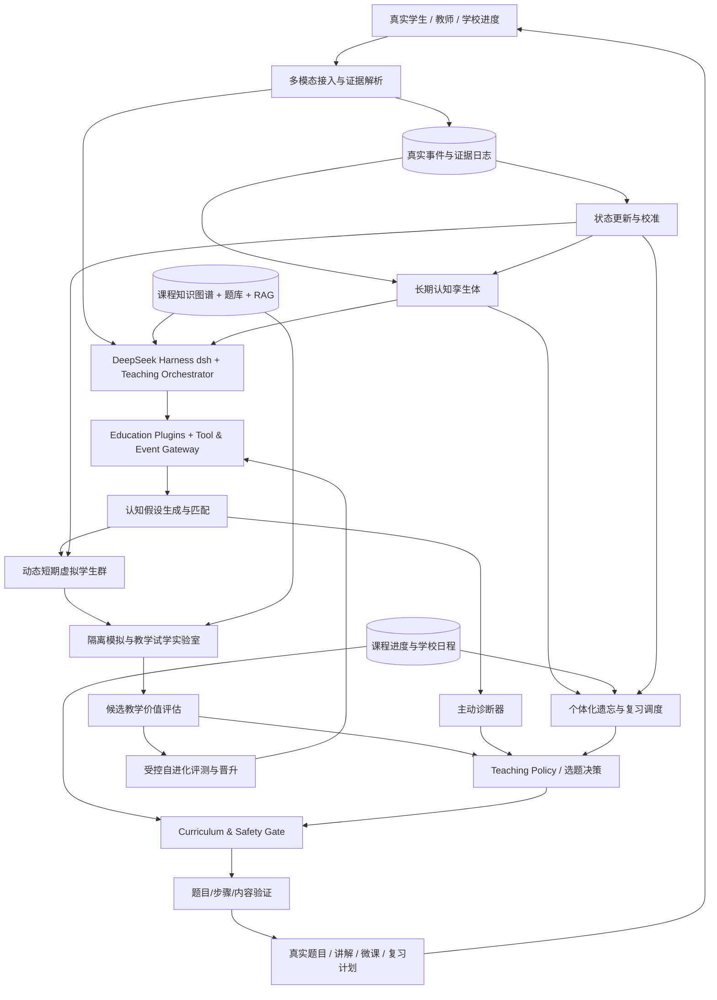
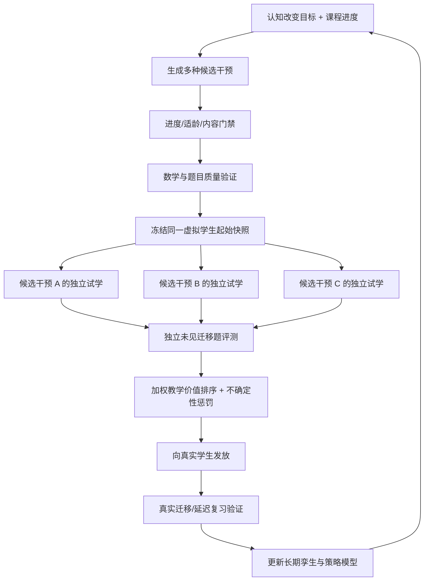
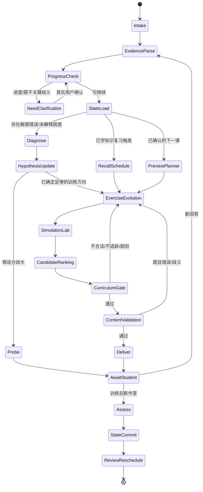
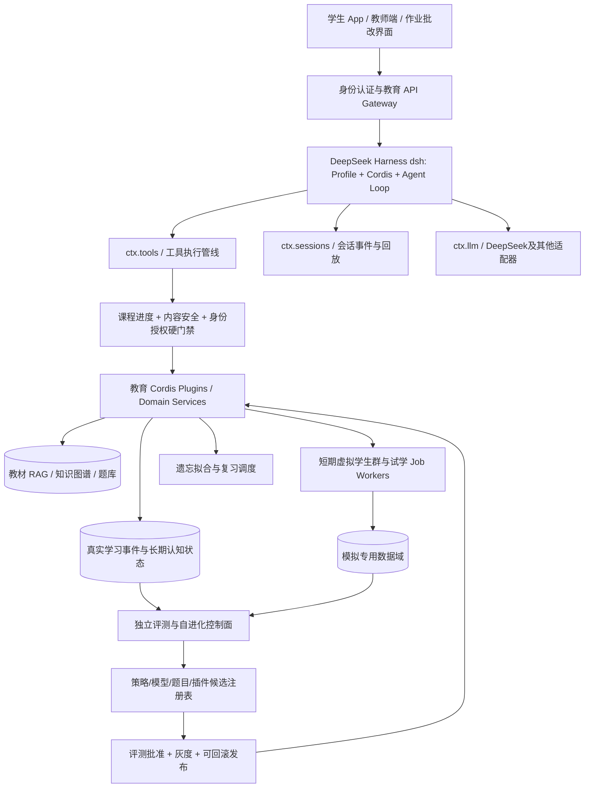
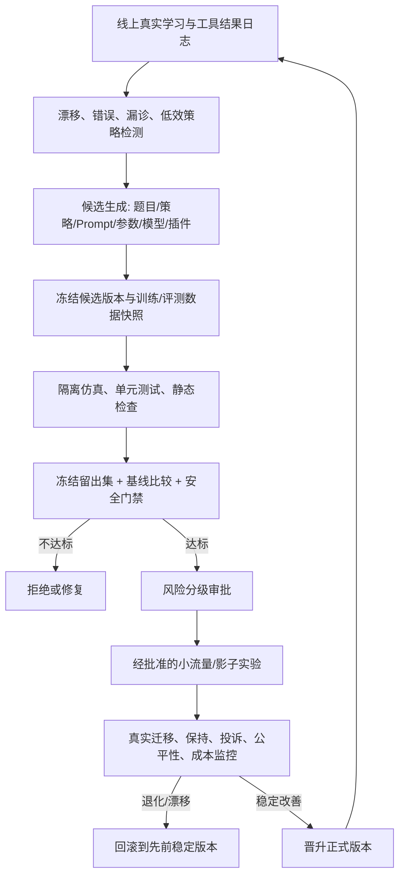
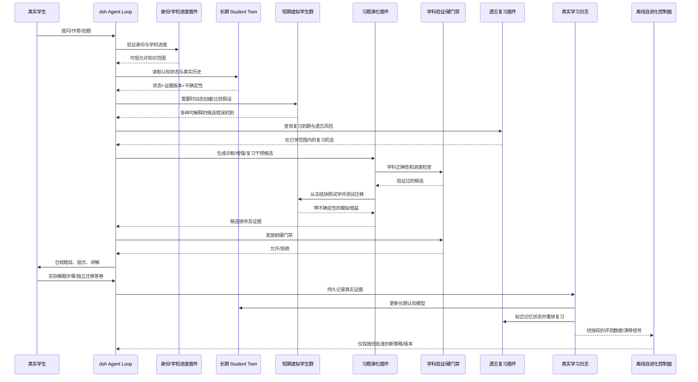

# 自适应认知孪生教育 Harness：完整系统架构与运行逻辑

> **Adaptive Cognitive Twin Education Harness — Full-System Architecture & Operating Specification**  
> 版本：1.1（完整目标状态：DeepSeek Harness 基座 + 教育插件 + 受控自进化）｜更新：2026-10-27  
> 定位：涵盖初中、高中、专科、本科等学习阶段，以学校课程为主节奏，提供拍题、批改、讲题、交互课程、诊断、主动出题、预习、课堂增强、复习、长期认知拟合与个性化教学。  
> 文档性质：**完整目标架构与技术规范，不是 MVP、阶段计划或实施排期。**
> 技术基座：**DeepSeek Harness（dsh）/ Cordis 插件运行时**，在其之上独立扩展教育域 Services、Plugins、Tools、Policies 与 Evaluation。DeepSeek 模型是可选/默认模型提供方，**DeepSeek Harness 不等同于模型本身**。
> 重要边界：截至本版撰写时，dsh 官方声明处于开发者预览、快速迭代、尚未经安全审计；下文是**面向生产目标的改造设计**，不是对开源预览版现有生产能力的保证。[R11][R12]

---

## 0. 执行摘要

本系统不是“把大模型接上题库的搜题工具”，也不是“通过正确率预测考试分数”的机器。系统的工作单位是**真实学生在特定课程进度下的可观察学习事件**：提问、尝试步骤、错误修正、提示后的反应、独立迁移作答、延迟复习表现，以及经学生/教师确认的学校授课进度。

系统基于 DeepSeek Harness 的插件式 Agent 基座运行：将模型、工具、会话事件、插件依赖、权限、审计与沙箱视为可组合基础设施；将教育业务状态、可信课程边界、认知拟合、教学效果和自进化评估保留为独立受控领域服务。其上同时维护：

1. **长期认知孪生体（Long-term Student Twin）**：每位真实学生拥有一个持续更新、可回滚、带不确定性的认知状态，记录知识掌握、可观察解题策略、错误规则、学习经验和个体化遗忘模型。
2. **动态短期虚拟学生群（Short-term Hypothesis Ensemble）**：围绕当前问题动态创建多个认知解释假设，在隔离环境中模拟解题和响应不同教学干预；可以分裂、合并、增权、降权、归档或终止。
3. **课程进度约束（Curriculum Progress Gate）**：以学校实际授课进度、近期预习窗口、已学知识范围为硬约束；默认不自动向学生推送尚未学到的后续课程题目，允许针对已学前置知识回溯补强。
4. **自适应诊断（Active Diagnosis）**：不是“错哪补哪”，而是借助先修知识图谱、错误机制和模拟行为，主动选择能区分不同认知假设的诊断题或追问。
5. **习题演化与虚拟试学（Exercise Evolution & Simulation Lab）**：围绕认知改变目标生成候选习题、提示、反馈、微课，先对虚拟学生进行受控试学，筛选模拟有效的教学干预，再让真实学生作答。
6. **遗忘与复习控制（Forgetting & Review Scheduler）**：根据个体化记忆稳定性、检索成功率、时间间隔、提示强度、解题迁移和课程/考试安排拟合遗忘风险，统一安排预习、同步学习和间隔复习。
7. **真实反馈校准（Grounded Feedback）**：**只有真实学生的可观察行为才能成为学生真实能力变化的直接证据**；模拟只产生候选假设和策略优先级，不能被当成真实学习结果。
8. **DeepSeek Harness 教育插件生态（Education Plugin Fabric）**：以 dsh/Cordis 的 service、typed event、tool registry、agent loop 与可逆注册为扩展点；功能插件支持显式依赖、权限、版本、卸载与组合；课程和安全硬门禁不能被插件绕过。
9. **受控自进化（Governed Self-Evolution）**：知识内容、学生认知状态、教学策略、虚拟学生模拟器、提示与工具插件可以持续优化；候选改动必须经离线评测、真人反馈、隔离测试、批准与可回滚发布，严禁未经授权自行改写生产系统。

### 0.1 系统中心目标

> 在**不要求 24 小时监测学生**的前提下，利用每次真实学习交互，不断校准学生的认知模型，尽可能以少量、适时、合规且符合学校进度的教学干预，提升学生**独立解题能力、思维迁移能力和长期保持能力**。

### 0.2 不可妥协的系统不变量

- **真实/模拟隔离**：模拟数据不得写成真实学生作答事实，模拟正确不能直接提升真实学生掌握度。
- **课程边界优先**：未经允许，不因模拟收益高就推送后续章节知识；题目所需全部核心知识点必须经过进度校验。
- **可观察性优先**：不宣称“读取学生真实思维”；只能从作答与交流中提出、验证有证据支持的认知机制。
- **独立评测**：训练题、解释、答案和迁移评测必须隔离；任何自适应策略必须对比非模拟基线。
- **模型表达不确定性**：允许“原因未知”“证据不足”“多种解释共存”。
- **学生控制权**：允许暂停训练、查看/纠正学校进度、解释推荐原因，依法进行数据删除与授权管理。
- **安全性**：题目和讲解必须通过学科验证；批改不确定时应明示并允许复核。
- **插件最低权限**：第三方插件和自动生成插件默认无学生原始数据、无数据库写权限、无凭据、无任意文件与网络访问；按能力单独授权并审计。
- **自进化与教学效果分离**：优化器不能仅用自己的模拟结果宣布自身变好；关键更新必须过独立冻结评测集与真实学生对照验证；安全策略、课程门禁、权限范围不能被自进化降低。

---

## 1. 能力边界与关键术语

### 1.1 系统提供的完整产品能力

| 能力 | 输入 | 主要输出 | 与核心 Harness 的关系 |
|---|---|---|---|
| 拍题识别 | 图片、公式、图像、手写 | 结构化题干、已知量、学生步骤 | 证据入口 |
| 自动批改 | 作业图、答案、步骤、评分规则 | 正误、步骤评分、错因候选与复核标记 | 观测和诊断 |
| 讲题问答 | 学生提问、尝试步骤 | 分层讲解、引导式提示、反例 | 教学干预 |
| 互动微课/网课 | 教材、知识节点、个人状态 | 讲解、互动、实验、随堂检测 | 课程干预 |
| 自适应诊断 | 当前错误、历史学习事件 | 候选根因、区分性问题 | 短期虚拟学生竞争 |
| 主动生成习题 | 认知改变目标、进度、遗忘队列 | 候选题、提示链、答案及迁移题 | 习题演化 |
| 预习 | 下次课堂内容、先修状态 | 入门预习、先修检测 | 进度控制 |
| 学校同步强化 | 本周授课、作业、诊断 | 弱点修复、同步练习 | 教学闭环 |
| 间隔复习 | 已学知识、延迟表现 | 复习顺序、强度、下次安排 | 遗忘模型 |
| 家长/教师报告 | 经授权的汇总事件 | 证据解释、课程进度、待关注点 | 可解释反馈 |

### 1.2 关键术语

- **知识点（Knowledge Component, KC）**：课程可测的概念或技能，例如“完全平方公式展开”“配方保持恒等”“链式法则识别”。
- **解题策略（Strategy）**：可观察的策略选择，例如数形结合、设未知数、分类讨论、代入验证。
- **错误规则（Misconception/Bug Rule）**：一种可复现的错误变换，例如错误地认为 `x²+6x=(x+3)²`。
- **证据（Evidence）**：真实学生可观测输出及其上下文；证据强度和可靠性各有差异。
- **认知假设（Hypothesis）**：解释特定行为的知识状态、技能缺口和错误规则组合；不是学生人格标签。
- **长期孪生体（Twin）**：对学生学习的持续、结构化、可审计的**估计状态**，不是一个持续自主运行的模型进程。
- **虚拟学生（Virtual Student）**：一个受显式能力边界约束、可模拟答题和接受教学响应的候选模型实例。
- **教学干预（Intervention）**：题目 + 提示 + 反馈 + 讲解 + 练习顺序的组合，而不必只是单一道题。
- **检索成功概率（Retrievability）**：在指定条件和时间点，学生能够独立提取/使用某知识的估计概率；不是等同于学科综合掌握度。

---

## 2. 全局架构与决策优先级

### 2.1 全局组件拓扑



### 2.2 决策优先级（从高到低）

1. 法律、隐私、年龄保护、安全与学科正确性。
2. 学校课程进度、学段内容限制与经授权的学生主动学习目标。
3. 真实证据与可信度、知识前置关系、时间预算与认知负担。
4. 学生当前认知状态、个体化复习紧迫性和教学目标。
5. 虚拟学生筛选结果、预期迁移收益及其不确定性。
6. 产品交互偏好、资源成本和体验优化。

**重要**：上层约束是可执行的后端策略，不能仅依赖 LLM Prompt。任何生成题目在展示前都必须调用进度与正确性门禁。

### 2.3 真实世界与模拟世界严格隔离

| 数据命名空间 | 写入者 | 用途 | 可否直接改变学生真实掌握度 |
|---|---|---|---|
| `observed_*` | 真实学生/教师、可信自动判题 | 真实证据与事件 | 可以，按证据权重更新 |
| `inferred_*` | 认知追踪与诊断算法 | 当前概率、假设 | 可以更新估计，但需记录依据 |
| `simulated_*` | 虚拟学生与试学环境 | 选择备选题、策略、主动询问 | **不可以** |
| `validated_*` | 规则/符号计算/人工审核 | 标准答案、可证明的步骤 | 可用于校验，不代表学生已掌握 |

---

## 3. 课程与学习知识空间：Graph + RAG + 题库

### 3.1 学段与课程本体

完整层级：`学段 → 年级/专业 → 学科 → 课程 → 教材版本 → 学期 → 单元 → 章节 → 知识点 → 子技能 → 解题规则`。

同一抽象概念跨学段可有**不同教学节点**：例如初中的一次函数、高中的函数与本科的映射/微分概念，使用 `concept_id` 建立语义联系，同时保留不同深度的 `curriculum_node_id` 和开放状态，避免一个概念关联导致越级教学。

#### 知识图谱节点

- Curriculum / Textbook / Lesson / CourseSession
- KnowledgeComponent / Subskill / Definition / Theorem
- Strategy / ProblemSchema / SolutionStep / Misconception
- Exercise / WorkedExample / Hint / LearningObject / AssessmentRubric
- LearningObjective / Prerequisite / TransferObjective

#### 关系类型及语义

| 边 | 含义 | 可信来源 |
|---|---|---|
| `REQUIRES` | 必需先修知识 | 课标/教材/教师审核 |
| `SUPPORTS` | 有帮助但非必要的相关知识 | 专家标注或审查后的统计关联 |
| `PART_OF` | 章节、知识点包含关系 | 课程结构 |
| `ASSESSES` | 题目检测一个或多个 KC | 教师审核的 Q-matrix |
| `USES_STRATEGY` | 题目/解法依赖的策略 | 解题标注 |
| `CAN_FAIL_AS` | 某个技能可能产生的特定错误规则 | 专家标注+历史数据 |
| `REMEDIATES` | 干预目标纠正的误解 | 教学设计和真实效果数据 |
| `TRANSFERS_TO` | 迁移能力相关性 | 课程目标+实验验证 |
| `IN_TEXTBOOK` | 与教材版本、页码关联 | 授权教学资料 |

**必须区分“语义相似”“常见共现”“先修依赖”“错误因果候选”。** Vector RAG 的相似性分数不能自动成为先修关系的可信证明；LLM 发现的新关系进入 `proposed_edge`，经校验后才能成为正式课程图谱。

### 3.2 文档索引与多路检索

检索流程：`学段与教材硬过滤 → 关键词/BM25 + 向量语义检索 → 知识图谱一跳/多跳关系扩展 → 结构化元数据过滤 → 交叉编码重排 → 返回带出处的课程上下文`。

向量检索适合查找相近题型、表达方式不同的提问及讲解；图谱适合查先修关系、教学边界；关系型数据库适合管理题目、课程和学生状态。多种检索手段不能相互替代。

教材内容应记录版权许可、版本、年级、具体章节、有效时间和来源；引用可追溯到页码、教学资源 ID 或授权地址。

### 3.3 题库必须有结构化标签

每道题至少标注：`item_id, source, license, stage, course, curriculum_node_ids, required_kcs, forbidden_future_kcs, q_matrix, strategy_ids, misconception_targets, difficulty, estimated_minutes, solution_steps, verifier_type, answer_spec, hints, hint_leakage_level, near_transfer_ids, far_transfer_ids, approval_status, exposure_count`。

**题目涉及的核心知识点是“求解实际必须用到的内容”，不是仅由题面关键词检索得到。** 题目需要专业审核/算法校验，尤其是含图、几何、开放性与多解题目。

---

## 4. Curriculum Progress Engine：学校进度驱动的三相学习系统

### 4.1 三条彼此独立的进度轴

1. `SchoolProgress`：**学校已教授/正在教授/即将教授/未教授**；按教材版本、学科、日期、课堂事件维护。可来自学生确认、学校授权同步、教师更新、作业讲义推断（需要确认）。
2. `CognitiveProgress`：学生真实**已经掌握/部分掌握/混淆/未知**；不因课堂讲完就自动掌握。
3. `AIAugmentationProgress`：平台已经**预习/强化/复习/迁移练习**的内容及实际效果；不反向伪造学校进度。

分别保存 `progress_source`、`confirmed_at`、`confidence`。仅靠上传一道超纲题，不得推断学校已经教到该单元。

### 4.2 三种学习任务的准入约束

| 场景 | 允许使用的内容 | 禁止/谨慎内容 | 教学目标 |
|---|---|---|---|
| 预习（Preview） | 下一次/近期学校将教内容的概念导入；已学先修复习 | 不得自动扩展到更后面的完整课程或大量超前难题 | 建立准备度、减轻下次课堂负担 |
| 课堂同步增强（Learn） | 已经教授或正在教授的知识；相关历史先修补强 | 未学的后续章节核心方法 | 补思维缺口、练当下技能 |
| 复习（Review） | 已学知识、曾出错的解题规则、跨已学单元迁移 | 未学先修以外的新核心课程 | 延迟保持、检索熟练、纠错迁移 |

**倒退修复允许跨年级**：高一配方法出错可以回到初中的完全平方公式。**超前开放默认不允许**：除学生/教师明确要求的额外拓展学习模式外，不推送未教授的后续课程；拓展模式仍需内容适龄和明确标记，与常规学校同步状态隔离。

### 4.3 课程门禁算法

给候选题 `q`、学生 `u`、模式 `m`：

```text
allow(q,u,m) = safety_ok(q)
             ∧ verified_content(q)
             ∧ grade_appropriate(q,u)
             ∧ all(required_kcs(q) ⊆ allowed_kcs(u,m))
             ∧ no_unapproved_future_method(q,u,m)
             ∧ cognitive_load_within_budget(q,u)
```

- `allowed_kcs(u, Preview)` = 已经学过的知识 + 课程已确认的**下一课/近期预习集合**（但高阶应用深度受限）。
- `allowed_kcs(u, Learn)` = 已教/正在教知识及其允许回溯的先修集合。
- `allowed_kcs(u, Review)` = 已教内容及经过确认的先前已学内容。
- 若标注置信度过低、题目隐藏使用未教公式，门禁采用 fail-closed：转为更安全的题或请确认进度。

### 4.4 课堂作为外生事件

`SCHOOL_LESSON_REPORTED` 表示接触过内容，**不代表已掌握**。真实学生在学校可能获得系统看不到的教学，因此 `time_gap` 不能被解释为“学生在这段时间完全没有学习”；缺乏观测时只能降低模型把握度或根据不确定性做短测确认。

---

## 5. 长期认知孪生体 Long-term Student Twin

### 5.1 多层状态表示

```yaml
student_twin:
  student_id: pseudonymous_id
  curriculum:
    stage: high_school
    subject: mathematics
    textbook_version: configured
    school_progress: confirmed_node_ids
    upcoming_lessons: confirmed_lesson_ids
    progress_confidence: 0.95
  knowledge_state:
    - kc_id: algebra.completing_square
      exposure_state: taught
      mastery_posterior: {mean: 0.63, uncertainty: 0.18}
      retrieve_probability: {at_horizon_days: 7, p: 0.46}
      transfer_estimate: {near: 0.59, far: 0.25}
      evidence_ids: [ev_1, ev_4]
  strategy_state:
    - strategy_id: verify_by_expansion
      observed_frequency: 0.30
      support_level: tentative
  misconception_beliefs:
    - rule_id: square_without_compensation
      posterior_weight: 0.51
      evidence_ids: [ev_2]
  review_state:
    memory_model_version: fsrs_or_calibrated_custom
    pending_review_events: [rv_100]
  pedagogical_preferences:
    examples_helpful: {weight: 0.4, sample_count: 5}
  model_meta:
    version: 54
    last_observed_at: 2026-10-25T20:00:00+08:00
    calibration_profile: cohort_shrinkage
    unresolved_hypotheses: [hyp_12, hyp_15]
```

> 上述概率仅为结构示例，不是基于真实学生数据得出的估计。

### 5.2 认知状态不能压缩为一个“掌握率”

对每个知识点分别估计至少四个量：

- **Conceptual understanding**：概念、定义和为什么成立。
- **Procedural fluency**：正确执行方法和计算的能力。
- **Strategy selection / transfer**：在新题中选择适当方法并迁移的能力。
- **Retrieval / retention**：经过一段时间后独立提取并使用知识的能力。

一个学生可能能迅速背出求导公式，但仍不理解链式法则适用条件；也可能理解配方法，但计算时出现偶发遗漏。四者不可混为一个百分比。

### 5.3 可观察思路表示，而非“读心”

每次解题按有向步骤图存储：`步骤节点 + 数学表达式/自然语言解释 + 采用的操作规则 + 前后依赖 + 校验结果 + 置信度`。

```text
题干 → 选择配方法 → 变换 x²-6x+5 → 写成 (x-3)²+5 → 得到最值 5
                    └─ 错误：引入 +9 但未补偿 -9
```

模型可以推断“存在恒等变形补偿相关误区的证据”，但不能断言学生心中一定存在该想法。对没写步骤的答案，证据尤其薄弱，应通过追问获取，而不是补造学生的思维轨迹。

### 5.4 长期状态更新

必须使用**事件溯源（event sourcing）**和版本化状态：原始真实事件不可更改，推断状态可以重建/回滚；学生或教师的纠错形成新事件而非删除历史证据。核心更新：

```text
观测事件 → 数据质量校验 → 题目/策略标签 → 模型似然更新 →
假设状态更新 → 遗忘记忆更新 → 教学事件归因标记 → 状态快照
```

模型须保留 `unknown` 及未观测学校学习活动的可能性；对长期无人作答的知识，通常先上调不确定性或安排校准练习，不直接判成“不会”。

---

## 6. 动态短期虚拟学生群：生成、匹配、分裂、合并与淘汰

### 6.1 每个虚拟学生是什么

一个短期虚拟学生是结构化认知假设 `H_i`，包含：

```yaml
virtual_student:
  hypothesis_id: hyp_12
  parent_twin_version: 54
  subject_scope: [completing_square, quadratic_minimum]
  knowledge_assumptions: {identity_expansion: weak, parabola_vertex: partial}
  strategy_policy: [attempt_square_completion, seldom_expand_to_check]
  bug_rules: [square_without_compensation]
  predicted_observable_behaviors: [specific_step_errors, question_types]
  response_to_intervention_hypotheses: [visual_balance_explanation]
  posterior_weight: 0.42
  evidence_refs: [ev_2, ev_5]
  uncertainty: high
  simulator_version: simulator_vN
  status: active
```

虚拟学生不是“粗心型”“学霸型”等性格标签，不得通过心理人格刻板印象解释理科错误。它的最小单位可以是一条错误规则或策略缺口，不必完整模拟一个人。

### 6.2 动态数量（0 到 N）的算法规则

- **Spawn**：出现现有假设无法解释的步骤、新类型提问、冲突证据、新学科范围，生成新的候选。
- **Split**：假设既能解释“公式不会”，也能解释“等式补偿不会”，且可通过新题区分时拆成两个模型。
- **Reweight**：对学生新的真实行为计算各假设预测似然，按后验更新权重。
- **Merge**：两个假设的知识规则与未见题预测几乎不可区分，合并权重、保留来源历史。
- **Prune/Archive**：长期与真实证据不一致且没有独特解释力的假设暂归档；未来可恢复。
- **Resample**：有效假设多样性降低时，在受证据约束下提出新假设，而不是机械复制最高权重模型。
- **Unknown**：所有候选解释力低时，不强制选择；新增未知原因并寻求真实学生证据。

`N_active` 由不确定性、候选分歧程度、预计信息收益、时延及成本预算动态决定；系统不要求每次都启动多 Agent，清晰已知的任务可 `N_active=0`。

### 6.3 观测匹配：Bayesian / Particle-style Belief Update

令 `H_i` 为候选学生模型，`E_t` 为第 t 次真实观测，`C_t` 为题目、提示强度和学校进度上下文：

\[
P(H_i\mid E_{1:t},C_{1:t})\propto P(E_t\mid H_i,C_t)\,P(H_i\mid E_{1:t-1},C_{1:t-1}).
\]

实际中需要：①对漏猜/偶发失误加噪声项；②多个假设之间避免共享同一错误源造成后验虚假尖锐；③对概率校准，防止 LLM 直接输出精确似然；④在新题上评估行为预测而非复述已有错误。

### 6.4 约束式行为模拟

推荐模式：`显式知识状态 + 限定的技能/错误操作集合 + 题目情境 + 学生模拟模型 → 可观察答案/步骤`。LLM 负责自然语言与候选行为生成；状态引擎约束它不应随意变成全知模型；工具化验证器判定输出到底遵循了假设中的规则。

**不要求虚拟学生的基础模型权重真的“学习”。** 各教学实验使用相同基础模型、独立状态副本，并通过可校准的转移模型模拟能力变化。若未来训练专门 Student Simulator，则另建模型版本与离线评估流程。

---

## 7. 反向溯源与主动诊断 Active Diagnosis

### 7.1 从结果定位到认知机制

1. `Observe`：获取学生的完整或部分作答。
2. `Localize`：通过符号、步骤、解法图定位首次偏离规则的位置。
3. `Expand`：结合错误规则图与 `REQUIRES` 关系，生成多个上游解释；识别可能属于偶发操作失误的情形。
4. `Simulate`：各短期学生在潜在诊断题上的可观察预测差异。
5. `ChooseProbe`：选预计最有区分度、最低负担且符合进度的诊断问题。
6. `Update`：真实学生答题后更新后验；证据不够继续问，足够则转入教学。

### 7.2 主动选题目标

基础目标是期望信息增益：

\[
IG(q) = H(H\mid E) - \mathbb{E}_{a\sim P(a\mid q,E)}[H(H\mid E,q,a)].
\]

实际优化目标同时惩罚过长题目、超前内容、不确定的答案、认知负担：

\[
q^*=\arg\max_{q\in Q_{allowed}}\{IG(q)+\alpha TeachingValue(q)-\beta Time(q)-\gamma Risk(q)\}.
\]

如果教师目标明确（例如需要直接完成家庭作业），不能无限诊断；可优先提供必要讲解，再安排一个简短验证题。主动诊断需要“少问、问得准、随时可跳过”的策略。

### 7.3 区分性诊断示例

真实学生误写 `x²-6x+5=(x-3)²+5`。可能的假设：

- H1：不知道配方必须保持恒等（补偿原则缺口）。
- H2：完全平方公式计算有误。
- H3：本次只是漏写常数。

依次选择的候选诊断题可能是：展开 `(x-3)²`；比较两个表达式在 `x=0` 时是否相等；另做一题不同系数的配方。系统根据真实表现决定是概念解释、公式补练，还是轻量检查习惯培养。

---
## 8. 遗忘曲线拟合：不是统一指数曲线，而是个体—知识—任务条件的记忆模型

### 8.1 遗忘管理的目标及边界

**目标**：在合理时间成本内维持学生对已学内容的**独立检索、正确运用与迁移**能力；不要把“学生忘了公式”与“学生从来不理解概念”混为一谈。

经典“遗忘曲线”提供复习必要性的直觉，但不能假设所有学生、所有知识点都遵循相同的遗忘速度。数学程序技能、事实记忆、策略选择和深层概念理解的保持过程不同；同一道题“看提示后会做”与“独立会做”也不一样。

因此将模型拆为三部分：

- **Memory Retention Model**：特定可检索知识/步骤规则在时间间隔后的可提取概率。
- **Knowledge Mastery Model**：学生是否理解和运用该知识，含概念、程序、策略和迁移。
- **Practice Policy Model**：基于遗忘风险、课程优先级、考试日期、认知负担决定何时、用什么题复习。

> `forgetting_risk` 只意味着“可能需要检查/复习”，不应自动提升题目难度或宣布“学生已经不会”。

### 8.2 候选模型层级与选型

| 模型/方法 | 适用对象 | 优点 | 局限与搭配 |
|---|---|---|---|
| 经验间隔复习 | 规则性事实、少量数据的知识点 | 易解释、可作为保底 | 不是个体化遗忘拟合 |
| Leitner / SM-2 | 卡片/步骤技能检索 | 简单，可维护复习间隔 | 对复杂思维迁移表达不足 |
| **FSRS / DSR** | 有足够复习历史的可检索知识 | 对稳定性、难度和回忆概率建模，可优化间隔 | 要把题目评分映射到真实检索表现；不是完整认知模型 |
| BKT + 遗忘项 | 练习机会随时间变化的技能状态 | 把学习与遗忘状态放入追踪框架 | 标准 BKT 往往不包含遗忘转移，需扩展 |
| IRT/多维 IRT + 时间项 | 难度不同的题目与技能 | 区分题目难度和学生能力 | 需要经过标定的题目参数 |
| HLR/生存分析/混合效应模型 | 预测给定时间后的回忆成功 | 支持个体与知识类型异质性 | 需要良好的时间戳和独立测验结果 |
| DKT / 序列模型 | 多知识点、较多历史交互 | 捕捉复杂时间依赖 | 可解释性、冷启动和偏差需单独处理 |

**推荐完整态**：对容易界定为“独立检索成功/失败”的学习单元采用 **FSRS/DSR 风格**，对多技能综合解题采用**校准的能力模型 + 认知模型/知识追踪 + 时间特征**，再由统一调度器融合二者。不是强迫整道综合数学题等价于一张记忆卡。

### 8.3 遗忘概率、稳定性和个体拟合

对于一个适合用记忆模型描述的子技能 `k`，可使用 FSRS-4.5 类似的检索概率示意式：

\[
R_{u,k}(t)=\left(1+\frac{19}{81}\frac{t}{S_{u,k}}\right)^{-1/2},
\]

其中 `u` 为学生，`k` 为可检索子技能，`t` 为距离上次有效检索的天数，`S` 为记忆稳定性；这一特定示意公式中，当 `t=S` 时 `R≈0.9`。**这不是所有版本 FSRS 的统一公式，也不是需要强行采用的固定参数；具体生产实现应按选定 FSRS 版本和优化器一致执行**。[R1]

系统维护：

```yaml
memory_state:
  learner_id: u_123
  memory_unit_id: square_formula_expansion
  model_family: fsrs_compatible
  model_version: fsrs_version_pinned
  stability_days: 8.2
  difficulty_state: 6.4
  last_independent_success_at: 2026-10-22T18:00:00+08:00
  observed_retrieval_quality: good
  expected_retrievability: 0.91
  parameter_posterior: cohort_regularized
  observation_count: 7
  uncertainty: medium
  next_review_at: 2026-10-31T18:00:00+08:00
```

上例数值仅展示字段，不代表真实计算。某个知识点的真实学生观测很稀疏时，不能把 1–2 次做对/做错拟合成高度精确的私人曲线。

### 8.4 训练/复习事件的质量判断

不是每一次答案正确都可以视为高质量回忆。系统为每一次练习记录：

- `independent`：是否未看答案/提示独立完成。
- `hint_level`：是否受到概念提示、步骤提示、最终答案提示。
- `success`：最终答案及各关键步骤的正确性。
- `latency`：作答用时（需考虑题目难度、录入方式与可访问性）。
- `confidence_self_reported`：可选的学生自评，不等于真实能力。
- `transfer_level`：原题、近迁移、远迁移。
- `context`：刚学后、隔天、考前、学校课程后等。
- `item_difficulty`、`required_kcs`、`strategy_ids`。

举例：`独立首次作答正确` 对记忆模型更新权重高；`提示完才改对` 应用于提示响应/学习转移建模，而不等价于一次完全独立检索成功；`只是阅读讲解` 不应当被记录成成功检索。

### 8.5 真正的“拟合”过程

1. **公共先验**：按年龄段、学科、知识类别设定合理的群体先验，避免冷启动极端预测。
2. **真实观测收集**：采集间隔不同的独立复习结果，以及学校未知活动造成的不确定性标签。
3. **参数估计**：在具备足够事件后，通过极大似然/贝叶斯后验/FSRS 优化器拟合个体参数；样本稀疏时使用**分层贝叶斯或群体参数收缩（shrinkage）**。
4. **分层个性化**：可按 `学生 × 学科 × 技能类别` 估计个体效应。避免每个知识点单独拟合过多参数导致严重过拟合。
5. **时间外验证**：用未来某时间点的未见真实复习结果评估概率校准、Brier score、log loss。
6. **模型重估**：新事件不断出现后增量更新，有明显分布变化时重训；保留旧参数版本与回滚能力。

复杂科学技能还应同时做概念性迁移检测，而不是仅以简单提取概率决定是否“学会”。

### 8.6 定义“下一次什么时候复习”

对于可检索知识，如果选择目标保持概率 `r_target`，在上述简化模型下可以反解下一次间隔：

\[
\Delta t = \frac{81}{19} S\left(r_{target}^{-2}-1\right).
\]

这是对应示意公式的数学推导。生产中由匹配的 FSRS 优化器/调度器求间隔，不应直接把公式在所有复习任务上硬套。

决定下次复习时间还需要综合：

- `target_retention`：学校目标和考试风险；难点、关键先修点可以要求更高的保持概率。
- `curriculum_importance`：当前或近期课程是否会用到该知识。
- `exam_horizon`：考试/测验日期与实际要求。
- `uncertainty`：预测不确定时优先短测试，而不是高强度教学。
- `daily_time_budget`：每天可用时间及课内负担。
- `interleaving/diversity`：减少机械重复同一种题型。
- `fatigue/load`：由学生主动反馈、时长和作答迹象保守推断，不将其诊断为医学状态。

### 8.7 复习队列的统一调度函数

对已学知识 `k` 计算复习优先级（结构式） ：

\[
Priority_{u,k}=
 a\,ForgettingRisk_{u,k}+b\,PrerequisiteCentrality_k+
 c\,UpcomingUse_k+d\,MisconceptionRisk_{u,k}+
 e\,ExamUrgency_k- f\,ReviewCost_{u,k}.
\]

- 权重不能凭 LLM 随意拍脑袋，应先有政策默认值，并通过真实长期学习效果校准。
- 不只复习最低正确率的知识，也要复习**即将遗忘、且对近期学习非常关键**的基础知识。
- 根据可用时间选择复习题、重学微课、近迁移、远迁移或仅一个快速诊断题。
- 当模型无法判断“忘了”还是“本来就未掌握”时，先诊断；前者重提取，后者重建概念。

### 8.8 与长期虚拟学生的交互

长期孪生体同时维护 `mastery_posterior` 和 `memory_state`。短期虚拟学生可包含三种不同机制：

- 学过但时间长未检索，表现似乎退化。
- 概念从未牢固建立，即使刚复习也会错。
- 知道概念但没有形成跨题型策略迁移。

虚拟学生针对不同间隔、提示、题型模拟表现，帮助选取区分性复习题。但**虚拟学生自己被更新后的成功率，不能充当真实学生遗忘曲线的样本点**。

---

## 9. 习题演化引擎：主动生成“能改变认知”的题

### 9.1 出题目标不是数量和即时正确率

系统接收 `LearningObjective`，例如：

```yaml
learning_objective:
  target_kc: algebra.completing_square_equivalence
  current_misconception: square_without_compensation
  desired_behavior: checks_expansion_and_preserves_identity
  school_mode: learning
  allowed_curriculum_nodes: [unit_1, unit_2]
  assessment: unseen_near_transfer
  time_budget_minutes: 12
```

出题必须反推需要改变的规则：

`当前可观察误区 → 目标正确推理规则 → 适合的认知冲突/对比任务 → 支架提示 → 独立迁移检验`。

### 9.2 候选干预的完整对象

**不是只生成一道题**，而是产生 `InterventionPackage`：

1. **学习目标**：需要纠正的具体错误或需要掌握的策略。
2. **训练题组**：对比题、反例题、逐步引导题、独立练习题。
3. **提示阶梯**：最轻微提示 → 指向性问题 → 可选分步演示；不提前泄露答案。
4. **反馈模板**：针对学生真实错误类型的解释，而非只说“你错了”。
5. **讲解资源**：学校教材对应讲义、动态图像或微课。
6. **独立迁移测试**：不同表面数字、结构或情境的未见题。
7. **完成判据**：正确步骤、策略解释、正确率、所需提示量及完成时间。
8. **进度证明**：所有所需 KC 已在允许教学集合中。

### 9.3 题型生成器（按教学目的）

| 题型 | 目的 | 示例 |
|---|---|---|
| 诊断区分题 | 区分多个认知假设 | 展开平方/验证恒等式 |
| 错因对比题 | 形成概念冲突和自我纠错 | 两个配方过程哪个保持恒等 |
| 最小反例题 | 打破错误规则 | 给 `x=0`，反例验证 |
| Worked Example | 初接触时降低无关负荷 | 示范配方每步并解释原因 |
| Faded Example | 逐步撤去支架 | 从填空步骤到独立完成 |
| 近迁移练习 | 同技能换参数或表面结构 | `x²+8x+1` 配方 |
| 远迁移练习 | 新情境中主动选方法 | 在图像、最值题中自主配方 |
| 自我解释题 | 训练理由表达 | “为什么必须减去 9？” |
| 交错练习 | 区分相近方法的适用条件 | 因式分解/配方法/公式法混排 |
| 间隔提取题 | 测试保持并更新遗忘模型 | 数天后独立完成类似新题 |
| 错误反思题 | 强化检查策略 | 找出匿名解答中的第一次错步 |

选择方法需根据学生前置基础与真实效果，不是对所有学生一律使用相同练习模板。

### 9.4 生成—校验—模拟—筛选—真实验证



### 9.5 题目的模拟“教学价值”

对候选干预 `a`，令 `H_i` 为虚拟学生假设、`w_i` 为匹配权重，`Gain(H_i,a)` 为从同一起点接受干预后在**保密迁移题**上的增益：

\[
U(a)=\sum_i w_i\,\mathbb E[Gain(H_i,a)]
-\lambda\,Time(a)-\mu\,Uncertainty(a)
-\nu\,Load(a)-\rho\,LeakageRisk(a).
\]

注意：

- `Gain` 最好由**与生成器隔离的、经真实数据校准的模拟和评分流程**估计；不是让生成器自己宣称“学生提升 30%”。
- 虚拟学生的知识状态更新要有实际可解释的受教机制（从误区修正到正确规则），不能仅把答案注入对话然后判定学会。
- 部分题更适合**诊断**而不是直接增强；该类题应以信息增益排序，不以模拟教学增益排序。
- 排序时应考虑最坏情况下的后悔值，避免对某个低权重但高风险认知假设产生显著负作用。

### 9.6 防模拟刷分 / reward hacking

- 每个候选干预从**同一学生状态快照**起跑；实验之间不得共享训练对话。
- 训练/验证/测试题各自独立；不能因为生成器见过迁移题就“学会预测”它。
- 同一底层模型兼任生成器和评估器时需要**独立规则验证器 + 数据隔离 + 偶发跨模型评估**。
- 维护真实对照组：同知识点同难度的普通习题、知识追踪推荐题、虚拟演化题。
- 模拟不能擅自修改长期孪生 `observed_*` 字段。
- 对随机错误、天赋化的全知表现及不遵守错误规则的虚拟学生，进行一致性测试，失败者不得参与评分。

---

## 10. 教学策略与预习—学校学习—AI 强化—复习的日常协同

### 10.1 教学策略路由器

Teaching Policy 的输入：`当前模式 + 知识掌握分布 + 虚拟学生假设 + 遗忘队列 + 近期学校日程 + 任务意图 + 时间预算`。

根据任务性质和证据选择以下行动：

- `ASK_DIAGNOSTIC_QUESTION`：假设冲突，先问一道区分性题。
- `GIVE_MINIMAL_HINT`：学生已经有策略，只卡在下一步。
- `SHOW_WORKED_EXAMPLE`：新知识或前置能力弱；避免过度认知负荷。
- `TEACH_MICRO_LESSON`：概念性误解尚未建立。
- `ASSIGN_TARGETED_PRACTICE`：已理解但仍需程序化练习。
- `ASSIGN_TRANSFER_TASK`：基础正确，需要验证换情境迁移。
- `SCHEDULE_SPACED_REVIEW`：已经学过且预计会忘记。
- `REQUEST_PROGRESS_CONFIRMATION`：学校进度含糊，禁止默认超前。
- `ANSWER_DIRECTLY`：学生明确要求答案或时间紧急时，在合理辅助学习体验下满足请求，不强迫诊断。

### 10.2 学校学习节奏（全态协调）

| 时段/事件 | 可观察数据 | Harness 动作 | 更新结果 |
|---|---|---|---|
| 前一晚/课前 | 明日课程（确认） | 预习先修短测、概念导入 | 预习证据、准备度 |
| 学校授课期间 | 未监测，除经授权的同步资料 | 不推断自动掌握；可以安静等待下一次交互 | 教学接触元数据 |
| 课后 | 学生询问、作业、课堂报告 | 拍题批改、认知诊断、同步强化 | 长期孪生与短期假设 |
| 错误集中暴露 | 反复错步、策略混淆 | 短期群探索 + 主动诊断 + 习题试学 | 定向练习和效果数据 |
| 每天计划复习 | 到期记忆单元 + 课程紧迫度 | 独立检索、交错练习、轻量迁移 | 记忆参数/复习计划 |
| 每周总结 | 所有已发生的学习事件 | 知识缺口、下一周学校节奏对齐 | 可解释周报 |
| 考试前 | 日期与覆盖范围（确认） | 调整复习优先级，不越过范围 | 考前强化与保持测验 |
| 假期/换学期 | 新教材或进度确认 | 新学期图谱映射、旧知识衔接 | 课程状态与先修桥接 |

### 10.3 每次学习会话中的时间分配

不存在所有学生通用的固定比例。由路由器动态分配 `preview_minutes / current_course_minutes / review_minutes / diagnostic_minutes / transfer_minutes`。例如当前课堂压力较大可把绝大部分预算给同步学习；新章节前出现先修缺口则加大预习补强；重要考试临近则增加回顾已学内容的比例。

**所有决策受学生设定的时长、学校作业负担以及休息偏好约束。** 不通过无限题海、连续追问来最大化系统指标。

### 10.4 教学提示的梯度

`激活已有知识 → 小问题提示 → 指向错误步骤 → 对比例子 → 局部步骤示范 → 完整讲解`。真实学生的每次提示级别进入日志。提示后同题答对不代表独立掌握，须用新题迁移验证。

---

## 11. 动态模拟实验室的严格运行机制

### 11.1 模拟环境组成

- `Scenario`：课程节点、当前误区、任务、题组、提示、允许步骤与题目答案。
- `Student Snapshot`：长期孪生体版本和多个短期假设的状态副本。
- `Environment Engine`：维护虚拟学生能看到的题目、提示、历史，执行隔离与防泄漏。
- `Student Behavior Model`：按指定能力边界生成可观察解法、步骤、错误与询问。
- `Tutor Policy Candidate`：可在模拟中选择教学提示、讲解、题目顺序。
- `Verifier`：独立判定每个步骤和迁移题结果。
- `Outcome Evaluator`：比较干预前后的迁移表现、步骤改进、提示依赖和模拟模型可靠性。

### 11.2 试学不是“做对一道题”

单次模拟至少区分：

```text
前测（独立） → 教学干预（训练题与提示） → 后测（未见近迁移）
                                              → 后测（未见远迁移，可选）
```

如果希望对长期保持做离线实验，应使用显式时间动态模型或经过真实延迟复习校准的记忆模型；不能仅把 Prompt 改成“7 天后”就认为模拟出了真实遗忘。

### 11.3 多候选模型在模拟中的集成

- **假设分布采样**：按当前后验权重抽取短期学生，而不是仅选择最大概率的一个。
- **误差独立性**：避免多个模型只是同一个 Prompt 略作改写、输出高度相关。
- **不确定性传播**：模拟收益的置信区间进入排名，低置信度策略保守处理。
- **失配反馈**：如果真实学生表现超出所有虚拟模型解释范围，触发 `MODEL_MISMATCH` 并更新候选集。
- **仿真能力边界**：LLM 无法被保证具有人类学习动力学；试学只用于候选策略筛选，必须在真人评测上复核。

### 11.4 可借鉴的开源项目

**MiroFish**：借鉴其知识图谱构建、基于实体的 Agent 画像、动态时序记忆、多轮仿真、报告 Agent 与模拟运行监控；它的 OASIS/Twitter-Reddit 社交行为空间与学生学习空间不同，不应照搬社交行为预测机制。[R2]

**Microsoft StudentSim（2026）**：借鉴“行为保真度 + 接受指导后的响应度”双指标、真实稀疏学习数据训练个性化学生模拟器、模拟器辅助教学策略实验的思路；仍需通过独立真实学生验证。[R3]

---
## 12. Harness 执行框架、状态机与 Agent/工具边界

### 12.1 Orchestrator 的职责与设计原则

主控 `Teaching Orchestrator` 构建于 **DeepSeek Harness（dsh）的 Agent Loop / Tool Registry / Session Event** 之上，并且必须是**有类型状态机 + 受限制的 Agent 决策器**，而非一个可以自由调用所有工具、自由更新学生状态的全权 LLM。领域工作流由教育插件与业务服务编排，不把业务规则直接塞进基础 Agent Loop；具体扩展点见第 25–28 章。其职责：

- 根据任务识别请求是拍题、批改、讲题、预习、课堂同步、复习或主动诊断。
- 加载真实学生、学校课程以及知识图谱的**版本化快照**。
- 在策略预算下选择需要运行的认知假设数、模拟次数、诊断深度与学习模式。
- 调用检索、判题、仿真、出题和遗忘调度工具。
- 确保任何学生可见的干预都通过课程、学科正确性和安全门禁。
- 对外给出可解释的建议，以及证据不足的情形。
- 记录每步执行轨迹、工具输出版本、耗时与成本。

**不允许** LLM 直接写数据库“学生知识点掌握度 90%”，也不允许将模拟答卷写为真人答卷；只接受受控事件接口提交证据，再由状态服务更新。

### 12.2 工作流状态机



上图表示完整系统可用的状态与回路，并非任何一次交互都必经所有状态。比如学生只是问一个定理定义，可能直接走轻量检索、进度门禁和讲解，不必启动虚拟学生群。异步任务可跨会话恢复，但不可谎称已完成尚未完成的模拟与学习判定。

### 12.3 Agent 角色（逻辑角色，不要求一个角色一个独立 LLM）

| 角色 | 输入 | 输出 | 禁止行为 |
|---|---|---|---|
| Intake / Evidence Parser | 图片/文本/语音/行为 | 结构化题干与步骤 | 捏造学生没写出的步骤 |
| Curriculum Agent | 教材、进度、题目标签 | 课程开放集合、状态建议 | 自行放行未授内容 |
| Reasoning Trace Analyzer | 学生步骤、正确解法 | 错步及策略证据 | 把猜测说成内心事实 |
| Hypothesis Generator | 当前状态与错误图 | 多种可区分认知假设 | 固定人格类型化 |
| Hypothesis Arbiter | 假设、新证据与似然 | 权重、分裂/合并/归档动作 | 直接用模拟更新真实掌握 |
| Student Simulator | 假设和试学场景 | 模拟答卷、提示反应 | 突破能力边界或泄露测试答案 |
| Exercise Generator | 认知改变目标 | 干预包/迁移题候选 | 生成未通过课程门禁的可见题 |
| Subject Verifier | 题目/步骤/解答 | 正确性、歧义、解答验证 | 未验证宣称唯一正确答案 |
| Teaching Policy | 状态、课程、复习、模拟收益 | 选教学动作与理由 | 超出学习时间预算 |
| Memory Scheduler | 复习观测、模型参数 | 记忆状态与计划 | 将阅读/提示后正确算作独立检索 |
| Quality/Eval Agent | 真实与模拟评测 | 校准、回归、风险告警 | 在训练数据上直接宣布有效 |

### 12.4 工具调用目录（建议 API）

```text
parse_multimodal_question(input_media, locale) -> ParsedQuestion
parse_student_trace(answer, steps, media) -> ObservedTrace
retrieve_curriculum_context(student_id, knowledge_scope, textbook_version) -> Sources
get_school_progress(student_id, subject) -> ProgressSnapshot
resolve_required_kcs(item_or_blueprint) -> VerifiedKCSet
check_curriculum_gate(student_id, item, mode) -> AllowOrReject
trace_first_invalid_step(question, student_trace) -> ErrorLocalization
query_prerequisite_graph(kc_ids, depth_limit, edge_types) -> CandidateRelations
read_student_twin(student_id, version?) -> StudentState
propose_hypotheses(evidence_ids, student_state, graph) -> HypothesisSet
score_hypotheses(observation, context, hypotheses) -> PosteriorUpdate
spawn_merge_prune(hypotheses, budget, evidence) -> HypothesisSet
select_diagnostic_probe(hypotheses, curriculum, time_budget) -> Item
build_intervention_package(objective, curriculum, rubric) -> CandidatePackage[]
validate_item_math(item, answer_spec, methods) -> ValidationResult
run_sandbox_simulation(snapshot, interventions, heldout_tests) -> SimulationReport
rank_interventions(sim_reports, policy_constraints) -> RankedActions
update_real_evidence(student_id, event, idempotency_key) -> EventID
recompute_knowledge_state(student_id, evidence_version) -> NewTwinVersion
fit_memory_model(student_id, review_events, model_version) -> MemoryPosterior
schedule_next_review(student_id, curriculum, memory_state, budget) -> ReviewPlan
record_school_lesson(student_id, lesson_id, source, confirmed) -> SchoolEvent
create_learning_report(student_id, time_window) -> EvidenceGroundedReport
```

每个工具都需要：输入/输出 JSON Schema、权限范围、运行版本、超时、幂等键、审计日志、错误类型与是否允许重试。长期写入采用事务/Outbox，避免题目发放成功却没有生成练习事件，或模拟进程重复写入状态。

### 12.5 关键结构化 API 示例

**出题请求**：

```json
{
  "student_id": "u_123",
  "mode": "learn",
  "school_progress_version": 15,
  "twin_version": 54,
  "learning_objective": {
    "target_kc_ids": ["algebra.square_compensation"],
    "misconception_rule_ids": ["bug.no_compensation"],
    "assessment_type": "near_transfer"
  },
  "constraints": {
    "max_new_items": 3,
    "time_budget_minutes": 12,
    "allow_future_curriculum": false,
    "require_independent_posttest": true
  }
}
```

**仿真结果**（永不混入真实观测事件）：

```json
{
  "run_id": "simrun_985",
  "source_type": "simulated",
  "student_snapshot_version": 54,
  "simulator_version": "sim_v3",
  "intervention_id": "int_209",
  "hypothesis_results": [
    {
      "hypothesis_id": "hyp_12",
      "weight_before_run": 0.42,
      "pretest_score": 0.2,
      "posttest_score": 0.6,
      "gain_distribution": {"mean": 0.4, "uncertainty": "high"},
      "notes": "illustrative_only"
    }
  ],
  "heldout_set_id": "eval_near_transfer_2026_v2",
  "is_real_student_evidence": false
}
```

**真实学生学习事件**：

```json
{
  "event_id": "ev_678",
  "source_type": "observed",
  "student_id": "u_123",
  "event_type": "INDEPENDENT_ATTEMPT",
  "item_id": "item_385",
  "occurred_at": "2026-10-26T20:15:00+08:00",
  "attempt": {
    "answer_text": "(x-3)^2+5",
    "step_ids": ["step_1", "step_2"],
    "hint_level": 0,
    "first_attempt": true
  },
  "school_progress_version": 15,
  "rubric_version": "rubric_v7",
  "consent_context": "learning_product"
}
```

**注意**：JSON 中标注了 illustrative 的值是字段示例，不是系统真实模拟输出。

---

## 13. 数据模型、存储与服务边界

### 13.1 核心实体与表

| 表/集合 | 关键字段 | 说明 |
|---|---|---|
| `students` | id, stage, guardian_consent, settings | 最小化身份数据 |
| `course_enrollments` | student, course, textbook, semester | 学生课程关联 |
| `curriculum_nodes` | node, type, stage, edition, parent | 课程标准层级 |
| `curriculum_edges` | source, target, edge_type, evidence, review_state | 知识图谱结构 |
| `school_progress_events` | course, node, status, source, confirmed, time | 学校进度真相源 |
| `items` | metadata, difficulty, kcs, solution, validation | 题库 |
| `item_kcs` | item_id, kc_id, weight, required | Q-matrix/步骤关联 |
| `solution_traces` | attempt, step, operation, validity, confidence | 可观察解题轨迹 |
| `learning_events` | student, event_type, timestamp, task, hint, metadata | 不可变真实事件日志 |
| `student_twin_snapshots` | student, version, state, evidence_hash | 长期认知状态 |
| `hypotheses` | student, session, parent, rules, posterior, status | 动态虚拟学生候选 |
| `hypothesis_evidence` | hypothesis, evidence, polarity, likelihood | 证据链 |
| `memory_units` | student, kc/subskill, S, D, model, uncertainty | 遗忘模型 |
| `review_events` | student, memory_unit, elapsed, independent, quality | 复习拟合事件 |
| `review_plans` | student, due_at, reason, status | 复习调度 |
| `intervention_packages` | objective, items, hints, feedback, version | 教学干预包 |
| `simulation_runs` | snapshot, agents, trial, seed, metrics, model | 隔离模拟记录 |
| `policy_decisions` | chosen_action, candidates, constraints, provenance | 决策可解释性 |
| `model_registry` | versions, train_data, eval, calibration, rollback | 模型治理 |
| `consents_and_access` | actor, scope, retention, audit | 未成年人保护与访问授权 |

### 13.2 推荐存储分层

- **PostgreSQL**：学生、课程、真实事件、结构化状态、认知假设、权限与事务。
- **pgvector / 专用向量库**：教材、问答、相似错误与题目语义检索；不能作为学生状态唯一真相源。
- **知识图存储**：初期可关系表表达 `REQUIRES`；需要跨课程深度路径计算可用图数据库 Neo4j/兼容图数据库。
- **对象存储**：拍题图片、手写答卷、授课资料、经授权的音频；加密与生命周期管理。
- **Redis**：会话状态、缓存、分布式速率限制；不作为长期证据唯一存储。
- **消息与工作流系统**：Kafka/Redpanda/NATS + Temporal/Celery 等，处理复习事件、仿真队列、模型重算和可恢复的工作流。
- **分析仓库**：存放最小化、去标识化、分级授权的数据用于离线评估和实验。

### 13.3 权限域划分

```text
student_private_domain   真实作答、身份、课程、长期认知状态
simulation_isolated      短期模型副本与实验结果
curriculum_public        合法授权教材索引、图谱和题库
analytics_deidentified   聚合、匿名/去标识化后的评测样本
teacher_guardian_scope   依具体授权开放的受限报告视图
```

禁止在跨用户检索中泄漏学生个体数据；通用训练数据集不得直接由未成年人私有答卷自动构成。删除/导出权限与保留策略应落实到对象存储、向量索引、缓存、仿真记录及备份生命周期。

---

## 14. 一次完整学习闭环：高中二次函数示例

假设真实学生学校已讲到二次函数最值，下节课是最值的综合应用，过往记录显示配方步骤出现两次错误；历史完全平方公式做对过，但已经较长时间没有独立复习。以下为**流程演示，不代表实际学习模型计算结果**。

**08:00 课前预习**

1. 学校进度引擎确定下一节的内容集合，禁止自动发放之后单元的导数题。
2. 记忆调度器发现“完全平方公式展开”的检索概率可能下降，并考虑该技能是今天配方的先修。
3. 系统生成一道 1 分钟的独立展开题；学生答对，日志记录 `hint_level=0`。
4. 记忆状态得到一次真实有效检索结果；暂不推断“所有二次函数知识已掌握”。

**18:30 课后拍题**

5. 学生上传 `x²−6x+5` 的配方过程，错误写成 `(x−3)²+5`。
6. 图像解析器确认原题和手写步骤；数学验证器定位首次失真的恒等变换。
7. 长期孪生体读取近期学习历史；候选 H1“不会补偿”、H2“公式错误”、H3“偶发漏项”。
8. 短期虚拟学生群分别模拟对若干诊断题的表现；主动诊断器选择最有区分度且允许的题：“展开 `(x−3)²` 并比较原式”。
9. 学生能正确展开，但不知道为什么仍要减 9；H1 后验上升。系统记录**证据支持**，不宣称读出了内心想法。

**18:36 生成与筛选增强训练**

10. 习题演化器提出候选 A：恒等式对比题；候选 B：展开检查题；候选 C：多道重复配方题；都限制在已学内容。
11. 题目校验器验证正确解及可能等价形式；课程门禁再次检查隐藏所需知识点。
12. 冻结同一起始学生状态副本，让若干短期虚拟学生在三个独立沙盒中尝试不同干预，使用隔离的近迁移题评估。
13. 评估器认为候选 A 在当前假设分布下更值得尝试，但模拟增益区间较大，标记“不确定”。
14. 教师 Agent 给出概念对比题，引导学生比较等式两边，再提供最轻量必要提示。

**18:45 真实能力验证**

15. 学生做一道未见的新配方题，并能解释补偿项的由来；这才是从真实答题获取的“有帮助”证据。
16. 长期孪生体更新“保持恒等”的概念理解估计；不会因单题正确将所有相关知识设为满分。
17. 假设 H1 获得修正；H2 如果已有较强反证可以归档，H3 保留低权重以避免过度确定。
18. 记忆调度器据本次独立结果与既往复习事件安排后续复习，不直接使用模拟试学结果作为记忆模型样本。

**几天后复习与再评估**

19. 在符合课业负担的日期，系统发放一题交错练习，让学生在配方法与因式分解之间自主选择。
20. 若学生独立使用合适策略并正确解决，更新程序性/策略性掌握和长期保持；若再次出错，打开新一轮短期认知假设搜索。
21. 真实结果回流到模拟器行为保真度与教学策略的离线统计，降低下一次不必要的诊断次数。

**产物**：不是只有“学生拿到了正确答案”，而是有完整证据链：`错步 → 认知假设 → 区分性追问 → 候选教学干预 → 真实迁移验证 → 记忆调度`。

---

## 15. 全态事件驱动运行逻辑（可转为服务代码）

### 15.1 会话处理伪代码

```python
async def on_learning_event(event: LearningEvent):
    assert event.source_type == "observed"
    assert consent_and_scope_ok(event)

    # 0. 事件防重、权限、可审计日志
    event_id = await observed_event_store.append_idempotent(event)

    # 1. 多模态证据和学习上下文
    parsed = await evidence_parser.parse(event)
    progress = await curriculum_service.get_confirmed_snapshot(event.student_id)
    twin = await twin_service.load_snapshot(event.student_id)
    task = classify_learning_intent(parsed, event, progress)

    # 2. 进度与可用范围必须先决定
    allowed_scope = curriculum_policy.allowed_knowledge(progress, task.mode)
    if parsed.has_critical_ambiguity or progress.requires_confirmation(task):
        return ask_minimal_clarification_or_safe_fallback()

    # 3. 所有观察事件进入真实证据层
    trace = await step_verifier.analyze_observed_steps(parsed)
    await evidence_service.attach(event_id, trace, source="observed")

    # 4. 同步更新认知估计；此时仅用真实证据，不用虚拟答卷
    twin = await state_estimator.update_from_observation(twin, event_id, trace)

    # 5. 选择任务分支
    if task.kind == "preview":
        objective = plan_nearby_preview(progress, twin)
    elif task.kind == "review":
        objective = review_scheduler.select_due_skill(twin, progress, task.budget)
    else:
        candidates = await hypothesis_engine.propose_and_update(
            twin=twin,
            evidence=trace,
            graph_scope=allowed_scope,
            compute_budget=task.compute_budget,
        )
        if candidates.need_more_information:
            probe = await diagnostic_planner.choose_discriminative_probe(candidates)
            if await curriculum_gate.allow(probe, progress, task.mode):
                return deliver_probe_and_suspend(probe, event_id)
        objective = teaching_policy.choose_objective(twin, candidates, task)

    # 6. 受约束出题、验证、模拟试学
    packages = await exercise_generator.generate(objective, allowed_scope)
    packages = [p for p in packages if await curriculum_gate.allow(p, progress, task.mode)]
    packages = [p for p in packages if await subject_verifier.approve(p)]
    if not packages:
        return deliver_verified_existing_material_or_request_human_review()

    sim_runs = await simulation_lab.run_isolated(
        snapshot=twin, candidates=packages, budget=task.simulation_budget
    )
    chosen = teaching_policy.rank_with_uncertainty(packages, sim_runs, task.budget)
    await policy_audit.record(event_id, twin.version, chosen, sim_runs)

    # 7. 展示给真实学生，等待真实反馈；不能提前宣称学会
    return await learning_delivery.send(chosen)


async def on_real_attempt_submitted(event: LearningEvent):
    assert event.source_type == "observed"
    await observed_event_store.append_idempotent(event)
    grade = await independent_grader.evaluate(event)
    prior_snapshot = await twin_service.load_snapshot(event.student_id)
    updated = await state_estimator.update_from_observation(prior_snapshot, event.id, grade)

    if event.is_independent_retrieval:
        await memory_model.update_from_real_review(event, grade)

    if event.is_unseen_transfer:
        await simulation_calibrator.append_real_outcome(event, grade)

    plan = await review_scheduler.reschedule(updated, await curriculum_service.get_confirmed_snapshot(event.student_id))
    await twin_service.commit_with_version_check(updated, event.id, plan)
    return explain_result_and_next_action(grade, updated, plan)
```

以上是**接口逻辑伪代码**，不是直接可运行实现；如某工具异步执行，要由工作流引擎负责持久化重试、取消、超时、恢复和状态版本检查。

### 15.2 状态一致性与并发

- `student_twin_snapshots.version` 使用乐观锁，避免学生多设备同时交作业造成最后写入覆盖。
- 事件 ID 和任务 ID 幂等；同一份图片上传重试不可重复更新掌握度。
- 模拟运行引用的是冻结的 `twin_version`；若真实学生在模拟中又做了新题，旧模拟只能作为历史试验，不得直接按旧排序继续强推。
- 课程进度更新要触发候选题有效性检查；已经生成但未发放的题，若涉及新进度冲突，必须重新门禁。
- 复习计划变更需要去重、合并相近知识点，防止重复推送。

### 15.3 失败降级路径

| 失败情况 | 系统动作 |
|---|---|
| OCR 对关键公式不确定 | 先确认题干/手写内容，再批改 |
| 符号验证器无法判断 | 标注不确定，换验证策略/人工审核 |
| RAG 没找到授权教材 | 使用通用可靠解释并标记教材来源缺失 |
| 学校进度不明确 | 只提供已确认内容或询问当前章节 |
| 虚拟学生全部失配 | 不推断根因，转向主动小测或标准讲解 |
| 仿真超时/成本超限 | 使用规则+知识追踪基线策略，不阻断学习 |
| 遗忘模型数据稀疏 | 回退到群体先验+保守复习提醒 |
| 策略推荐置信度低 | 选择低风险、可解释、短时反馈策略 |
| 学生拒绝诊断 | 提供选择权并在可能情况下直接答疑 |
| 监测到异常答题压力 | 减少练习量、建议休息，不诊断心理健康 |

---

## 16. 技术栈与模型层的完整选型地图

### 16.1 底层服务推荐

| 能力 | 可用工具/技术 | 作用 |
|---|---|---|
| Harness 主基座 | **DeepSeek Harness（dsh）+ Cordis 插件运行时 + 教育域状态机** | 基于现有 Agent Loop、会话事件、工具注册表和插件加载构建全部能力 |
| 长任务/可靠执行 | Temporal / 独立任务队列与工作流服务（可选） | 跨进程持久任务、仿真批处理、幂等、恢复与补偿；不替换 dsh 主基座 |
| LLM 推理 | dsh `ctx.llm` 适配器 + DeepSeek 系列模型/按任务选择的其他多模态模型 | 模型供应者可替换；OCR、几何图像理解、诊断候选、讲解与出题按能力路由 |
| 教学检索 | PostgreSQL、pgvector、BM25、重排序 | 教材/题库/误区多路检索 |
| 图谱检索 | 关系表递归查询 / Neo4j 等 | 先修路径、错误规则、跨课程联系 |
| 数学验证 | SymPy、数值代入、CAS、专用表达式等价检测 | 降低错误解与错误批改 |
| 几何/图像 | 几何求解器、绘图与数值仿真工具 | 验证涉及图形的解法 |
| 理化 | 单位检查、量纲分析、公式/数值仿真 | 防止物理/化学量纲与计算错误 |
| 编程题 | 隔离容器、单元测试、静态分析 | 语义/运行正确性，不依赖 LLM 主观判分 |
| 主观题 | Rubric + 双重评估 + 人工争议复核 | 过程性评价与不确定性提示 |
| 认知模型 | BKT、DINA/G-DINA、IRT/MIRT、PFA、序列知识追踪 | 掌握状态与题目难度建模 |
| 学生模拟 | 约束式 LLM + 显式规则 + 可选 StudentSim 式特化 | 可观察错误/提示反应的模拟 |
| 遗忘模型 | FSRS/DSR + 分层统计模型 + 时间特征 | 个体化保持与复习安排 |
| 推荐决策 | 信息增益、约束优化、Contextual Bandit、可选离线 RL | 选择诊断题/教学干预 |
| 音视频课 | TTS、ASR、分步动画/绘图、互动题组件 | 网课与即时反馈 |
| 插件运行与管控 | Cordis、dsh Profile / Bundle / Patch、`ctx.tools`、`ctx.sessions`、`ctx.agents` | 教育插件生命周期、扩展点、工具策略、可观察事件 |
| 自进化评测与发布 | 提议队列、版本仓库、冻结评测集、教师审核、A/B/OPE、CI/CD、Feature Flag、回滚 | 受控优化 Prompt/策略/模型/题目/插件，不允许直接自改生产代码 |
| 数据系统 | PostgreSQL、对象存储、事件总线、缓存 | 真相源与事件协同 |
| 评测与监控 | OpenTelemetry、Prometheus、实验平台、模型注册 | 延迟、成本、正确率、模型漂移 |

### 16.2 哪些问题靠什么解决

| 问题 | 优先方法 | 不应该误用的方法 |
|---|---|---|
| 讲解符合教材与章节 | 结构化课程 RAG + 进度门禁 | 仅靠微调记教材 |
| 解题思路分歧 | 步骤分析 + 多认知假设 + 主动追问 | 只看最终对错 |
| 学生忘了旧知识 | 个体记忆模型 + 独立检索试题 | 用统一 1/3/7 天表替代拟合 |
| 学生根本没学过 | 学校进度状态与学习暴露记录 | 判定为认知缺陷 |
| 虚拟学生学习反应 | 显式状态变化 + 特化模型 + 真人校准 | LLM 自我评价“学会了” |
| 选择最有效题目 | 约束式候选生成 + 离线试学 + 真人验证 | 题目生成器给自己打高分 |
| 降低成本 | 小模型/规则路由、缓存、按需模拟、蒸馏 | 无条件大规模多 Agent |

### 16.3 Fine-tuning 的位置

完整态可能包含多个专用微调模型，但不是以微调替代数据和策略体系：

1. `Step Error Classifier`：利用教师审核的错步标注数据细分错误规则。
2. `Student Response Simulator`：对真实稀疏学生记录做群体预训练与个体适配；更偏向行为保真与教学响应，而非全知识推理。
3. `Pedagogical Tutor Model`：学习分层讲解、恰当提示、错误定位与评分规范。
4. `Exercise Blueprint Generator`：生成具有可测认知改变目标的题组结构。
5. `Teaching Policy`：基于真实效果日志训练排序/决策模型；必要时研究 Contextual Bandit 或强化学习。

训练过程应遵守数据许可、儿童权益、学术数据使用范围。个体化记忆和当前课程进度默认存业务数据库，不应为每个学生每发生一条答题事件就在线训练大模型。

---

## 17. 跨学科适配层

共享的是**认知状态、课程进度、证据日志、虚拟试学与教学调度架构**，不能假设所有学科采用相同的验证器和掌握度模型。

| 学科 | 思维过程重点 | 诊断方法 | 关键工具与特殊性 |
|---|---|---|---|
| 初高中/高数 | 变形、定理使用、分类讨论、解题策略 | 错步与错误规则图 | CAS、步骤等价证明、函数绘图 |
| 物理 | 建模、受力分析、单位、极限情形 | 解释图示、分析物理模型 | 单位检查、符号计算、仿真 |
| 化学 | 反应机理、计量守恒、概念区分 | 反应步骤和守恒逻辑 | 方程式平衡、量纲与安全验证 |
| 编程/计算机 | 分解问题、抽象、测试、复杂度 | 代码轨迹和失败测试 | 沙箱、单测、静态/动态分析 |
| 英语/语文 | 阅读理解、语言表达、论证结构 | Rubric、错误模式、修改轨迹 | 文本对齐、多维评价、人审 |
| 专科实践课 | 操作流程、安全规范、岗位技能 | 程序步骤与标准作业流程 | 虚拟实验、专业 Rubric、行业规范 |

在化学实验、电学、高压装置、网络攻防等高风险场景，平台要对具体实践指导设置学科安全过滤和专业监管，不因为个性化教学需求而生成危险操作细节。

---
## 18. 学习科学方法如何真正进入 Harness

> 以下方法是不同场景下可调用的**教学策略工具箱**，而不是对每个学生同时启用所有干预。其有效性具有任务和条件边界，必须以真实学生数据进行个体化校准。[R4][R5]

| 教学方法 | Harness 的实现动作 | 使用条件 | 怎么验证 |
|---|---|---|---|
| Retrieval Practice（检索练习） | 不先展示答案，要求独立回忆或应用 | 已学内容，需要保持 | 无提示成功率、延迟测验 |
| Spaced Practice（间隔学习） | 结合记忆稳定性安排复习日 | 已经接触并有可测保持任务 | 一周/数周后的独立作答 |
| Interleaving（交错练习） | 混排易混方法与旧知识 | 基础理解建立之后，需要辨别策略 | 新题策略选择正确率 |
| Worked Examples（示范例题） | 给高质量分步示范 | 新内容或先修知识较弱 | 之后自行解题 |
| Fading Scaffolds（支架渐隐） | 逐步去掉填空、公式提示 | 部分理解但依赖提示 | 不看提示独立完成 |
| Self-explanation（自我解释） | 要求解释为什么这一步成立 | 概念理解与解题规则纠正 | 换题仍能解释关键原理 |
| Elaborative Interrogation（精细追问） | “为什么成立？反例是什么？” | 需要连接前置概念 | 反例与迁移题 |
| Contrastive Learning Tasks（对比题） | 对比正确/错误方法与易混概念 | 稳定错误规则 | 错误是否不再重复 |
| Productive Failure（有支持的尝试） | 先尝试，再给结构化提示 | 学生具备可用先修，失败成本可控 | 后续理解与迁移 |
| Mastery Learning（掌握学习） | 达到可验证标准再进入依赖性任务 | 有明确前置依赖 | 独立测试+间隔保持 |
| Metacognitive Prompts（元认知提示） | 预测答案、检查步骤、事后反思 | 缺少自我检验策略 | 自主纠错率与提示依赖下降 |
| Dual Coding / Visualisation（多表征） | 公式、图像、图示、文字互补 | 适合数形结合、物理建模等 | 跨表征迁移题 |
| Cognitive Load Control（认知负荷管理） | 控制信息量、一次处理一个错误 | 初学、题干复杂或学生过载 | 完成度与错误模式变化 |
| Error-focused Practice（错因专项） | 针对某错误规则生成变式 | 多次证据支持特定误区 | 未见题不再重复同类错步 |
| Near/Far Transfer（近/远迁移） | 将应用情境逐步拉远 | 基础程序已经稳固 | 未见应用题/综合题 |
| Self-regulated Learning（自我调节） | 共同设目标、反思学习计划 | 自主学习者/考试准备 | 计划完成质量和自主学习能力 |

### 18.1 组合规则而非“拼盘”

- 概念误解严重 → 先用**对比反例 + 自我解释 + 具体示范**，后用独立迁移题。
- 已理解但程序错误频繁 → **关键步骤训练 + 自检 + 渐隐支架**。
- 近期正确但久未复习 → **间隔检索 + 交错练习**，而非重讲整个课程。
- 不懂先修 → **先回溯旧知识**，再进入当前课程；切勿直接灌输后续高阶解法。
- 能做同类题却不会综合题 → **策略选择 + 跨题型迁移**，而非重复近似数字变式。
- 课堂尚未讲到 → **仅限近期受控预习**，不以学生能力高低自行解除门禁。

### 18.2 以教学目标定义评估单位

题目的“效果”要与所设计的目标一一对应：纠正等式恒等变换错误，就用未来新题中是否能够保证恒等关系来验证；训练策略选择，就测试能否在配方法、因式分解与公式法之间自主选择。只用一张总分表无法衡量具体认知改变。

---

## 19. 评测体系：从可用到真正有效的完整衡量

### 19.1 四级评测结构

| 层级 | 评测对象 | 关键指标 | 基线/对照 |
|---|---|---|---|
| L1 内容能力 | 拍题、判题、讲解、知识定位 | OCR 准确率、公式正确率、错步定位、引用准确率 | 教师标注金标准 |
| L2 认知拟合 | 长期状态与短期虚拟学生 | 未见题错误步骤预测、行为保真度、后验校准、有效假设数 | 只看正确率的 BKT/IRT、无模拟模型 |
| L3 模拟可用性 | 虚拟试学与教学响应 | 指导响应保真度、预测与真人结果一致性、离线策略排序相关性 | Prompt 扮演学生、随机策略 |
| L4 真实教学效果 | 真实学生接受系统后的变化 | 独立迁移、延迟保持、时间效率、错误复发率、长期完成率 | 教材同步练习、知识追踪推荐、教师设计题 |

**L4 是最高标准。** L2/L3 分数即使很好，若真实学习效果没有提升，也不能称为优秀的学习 Harness。

### 19.2 遗忘模型专属评测

- `Brier score / Log loss`：指定时间间隔后的检索成功概率预测是否准确。
- `Calibration Curve / ECE`：预测 80% 的检索事件是否大致 80% 成功。
- `Temporal holdout`：按时间留出未来测试，不能随机打乱同一学习历程后误当未来预测。
- `Sparsity stratification`：学习记录 1–3 次、4–10 次、10 次以上的校准质量分别报告。
- `Transfer retention`：旧知识应用在新题时的稳定性；不只看原知识卡片记忆。
- `Review efficiency`：达到相同保持目标时需要的实际分钟数、题量和总负担。

### 19.3 虚拟学生拟合与认知假设评测

- 行为保真：同一学生在未见问题上的正确率、**错误类型分布、错误发生步骤、策略选择**的符合程度。
- 教学响应：真实学生看到特定提示后如何修改答案，模拟器是否展现相似变化。
- 假设校准：真实教师标注的根因标签是否与高后验假设一致；无法确定时的拒判是否恰当。
- 抗错配：过去匹配良好、今天学生在学校新学会之后，是否能及时调整/不再固守旧状态。
- 采样效率：用几道诊断题可以排除不正确假设；学生被追问的主观负担。
- 消融研究：无短期群、固定单 Agent、动态群、只知识追踪等配置对比，验证动态虚拟学生的真实边际价值。

### 19.4 真正的教学因果效果

不能只比较“做完 AI 习题之后分数提高”，因为学生同时在学校上课、做其他作业，存在选择偏差和历史趋势。建议：

1. 在合规授权下，对适合的教学策略做**小范围随机或分层随机对照**，确保所有组都获得合理教育服务。
2. 对照组包括 `常规同知识点练习`、`基于掌握度的推荐`、`虚拟试学筛选的练习`。
3. 控制题目难度、耗时、先修掌握、学校课堂进度、重复练习次数。
4. 在训练外的独立新题、延迟测试和跨题型迁移题上比较。
5. 同时观测潜在不良效果：练习时长增加、无意义重复、过度依赖提示、挫败感。
6. 长期策略可研究 Contextual Bandit、逆倾向评分/双稳健离线策略评估，但只有在日志包含候选动作、选择概率和充分支持域时才有可靠条件；**离线估计不能替代真实验证**。[R6]

### 19.5 上线前必须通过的安全门槛

- 不得出现大量错误答案、高置信度误批改、错步捏造。
- 课程进度门禁无已知绕过路径，尤其是提示、迁移题和隐含解法。
- 未成年人权限与数据保护经独立审查。
- 虚拟学生输出不得污染真实证据或带入不必要身份特征。
- 自适应策略在未见真人数据上的表现达不到基线时自动降级，不强推。

---

## 20. 指标面板、运行成本与可观测性

### 20.1 关键运行指标

| 维度 | 指标 |
|---|---|
| 学生学习 | 独立正确率、步骤错误复发、近/远迁移、延迟保持、提示依赖、学习时间 |
| 课程同步 | 学校进度置信度、预习窗口命中率、超前题拦截数、进度冲突 |
| 认知拟合 | posterior 校准、未知原因比例、假设分裂合并频次、诊断题信息效率 |
| 习题生成 | 验证通过率、歧义率、重复率、虚拟/真实增益差、题目覆盖度 |
| 遗忘模型 | 复习到期准确率、时间外 Brier/log loss、失配率、复习负担 |
| 基础设施 | 单次会话模型调用、模拟 token 成本、工具耗时、缓存命中、工作流失败率 |
| 公平与安全 | 年龄/教材版本分组错误率、教师争议复核率、越界建议、数据访问异常 |

### 20.2 控制成本的原则

- 以**题型路由**控制 LLM：公式等价验证优先用符号工具，普通进度查询不需要长上下文推理。
- 大多数会话无需多个完整模型实例：短期模型可共用 LLM，但维护独立状态和受控输入。
- 使用 **expected value of computation**：只有增加模拟可能改变教学决策，才追加虚拟学生数量或回合。
- 高频通用题共享已验证教材索引、题目与解答缓存，绝不共享私有学生记忆。
- 学习报告、复习计划、仿真探索可以与立即讲题解耦；用户眼前的教学不依赖昂贵模拟全部跑完。
- 重要的策略质量改进尽量在离线实验完成；实时仿真保持严格预算。

### 20.3 每条推荐的可解释审计记录

推荐记录应能够回答：

> 为什么现在发这道题？它属于学校哪一章？检测什么已学先修？当前有什么可观察证据？有哪些备选假设？为什么不是另一道题？参考了哪些真实复习数据？用过哪些模拟？模拟有多不确定？做完后用什么新题检验？

学生端只需简洁解释“因为你在配方时多次漏掉补偿项，我先安排一个恒等变形对比题”；教师/研发端可查看更详细的证据、策略、版本和评测，而不泄露其他学生数据。

---

## 21. 隐私、安全、未成年人保护与内容治理

### 21.1 最小化采集原则

- 以**学习事件**为中心，不监控学生 24 小时的设备、位置或其他与学习无关的行为。
- 学生学校进度优先由本人/教师授权确认，避免从无关个人信息推断。
- 短期虚拟学生画像只包含学习技能、可观察错误和任务上下文；避免用敏感身份变量形成刻板印象。
- 拍题照片中的姓名、班级、其他学生信息应尽可能遮蔽或最小化存储。

### 21.2 数据治理与模型隔离

- 明确未成年用户适用的监护同意、权限与信息处理限制，按目标市场法律与教育监管要求评估。
- 原始学生答卷加密、审计访问、设置保留期、提供可用的导出/纠错/删除机制。
- 像素图片、教材片段、学习档案、向量嵌入和模型训练副本都在数据生命周期管理范围内。
- 训练个性化模拟器之前必须确认真实数据来源和允许的用途，避免在未经授权情况下以儿童私有数据构建公开训练集。
- 教育推荐不应被用于未经正当授权的高风险学生标签、惩罚、招生淘汰或身份画像决定。

### 21.3 学术诚信与教师权责

- 教师可以查看 AI 的教学依据、覆盖范围和不确定性，并覆盖错误课程标签。
- 主观题/开放题允许申诉和人工复评。
- 当真实学生需要时可以直接回答，但产品可提供“只给提示”“逐步引导”“完整讲解”模式。
- 在课程评价等高风险场景，AI 建议必须由学校/教师规定的规则复核。

### 21.4 开源许可

DeepSeek Harness 官方仓库为 **MIT 许可证**，但其开发者预览版明确声明未经安全审计、不保证生产安全；必须对第三方组件、外部插件与依赖另行核验。[R11][R12] MiroFish 官方仓库包含 **AGPL-3.0** 许可证文件。[R2] 直接复用、修改并部署为在线服务时，需要进行具体的开源合规评估。建议**借鉴机制并独立实现教育域模型**，不要未经法律评估直接复制整套代码。StudentSim 仓库的许可证与训练数据/模型权利需分别核验，不能因代码开源推定所有学习数据都可商用。[R3]

---

## 22. 全系统交互协议与质量约束（供研发实现）

### 22.1 主要事件清单

```text
USER_QUESTION_SUBMITTED
QUESTION_IMAGE_UPLOADED
STUDENT_TRACE_SUBMITTED
INDEPENDENT_ATTEMPT
HINT_REQUESTED
ANSWER_REVISED_AFTER_HINT
SCHOOL_LESSON_REPORTED
SCHOOL_PROGRESS_CONFIRMED
TEACHER_FEEDBACK_SUBMITTED
ASSESSMENT_GRADED
HYPOTHESIS_CREATED
HYPOTHESIS_SPLIT
HYPOTHESIS_MERGED
HYPOTHESIS_ARCHIVED
DIAGNOSTIC_PROBE_SELECTED
SIMULATION_STARTED
SIMULATION_COMPLETED
INTERVENTION_SELECTED
INTERVENTION_DELIVERED
UNSEEN_TRANSFER_ATTEMPTED
REVIEW_DUE
REVIEW_COMPLETED
MEMORY_MODEL_REFITTED
TWIN_RECALCULATED
CURRICULUM_GATE_REJECTED
QUALITY_REVIEW_REQUESTED
EDU_PLUGIN_LOADED
EDU_PLUGIN_UNLOADED
EDU_PLUGIN_PERMISSION_DENIED
EDU_CAPABILITY_VERSION_CHANGED
EVOLUTION_PROPOSAL_CREATED
EVOLUTION_CANDIDATE_SANDBOXED
EVOLUTION_OFFLINE_EVALUATED
EVOLUTION_CANDIDATE_REJECTED
EVOLUTION_HUMAN_APPROVED
EVOLUTION_CANARY_STARTED
EVOLUTION_PROMOTED
EVOLUTION_ROLLED_BACK
EVOLUTION_DRIFT_ALERTED
```

事件必须有 `event_id, occurred_at, observed_at, source_type, student_id_or_scope, session_id, provenance, model_versions, schema_version, consent_scope`。模拟事件用独立类型和存储域；任何共享事件总线消费者不能凭字段名误将模拟写到真实学生知识状态。

### 22.2 必须实现的断言 / Property-based Tests

```text
ASSERT: simulated_event cannot mutate observed_student_evidence
ASSERT: unverified_school_progress does not unlock future_core_kc
ASSERT: rejected_curriculum_item cannot reach student_delivery
ASSERT: tutoring_hint_exposure != independent_retrieval_success
ASSERT: question_solution_verified_before_grading_reference
ASSERT: every mastery_update references actual evidence_ids
ASSERT: stale_twin_simulation cannot auto-override newer student_state
ASSERT: student_data_never_crosses_tenant_or_student_access_boundary
ASSERT: inability_to_explain_can_result_in_unknown_hypothesis
ASSERT: deleting student data propagates to derived stores per policy
ASSERT: plugin cannot bypass curriculum_or_safety_gate
ASSERT: plugin default_permissions are deny_by_default
ASSERT: model_generated_student_id cannot authorize_data_access
ASSERT: simulated_gain cannot be sole_reward_for_policy_promotion
ASSERT: self_evolution_candidate cannot_mutate_production_without_approval
ASSERT: deployment_and_rollback_are_versioned_and_auditable
ASSERT: prompt_or_rag_content_cannot_change_tool_permissions
ASSERT: failed_plugin_unload_revokes_effects_and_credentials
```

### 22.3 “全态完成”验收清单（不是实施阶段）

以下是完整系统应具备的能力和安全属性，而不是先后开发顺序：

- [ ] 实时追踪学校/学生/AI 三条进度轴，预习窗口由确认的课程日程驱动。
- [ ] 对每道学生可见的题执行课程边界检查，允许向前回溯已学基础，不默认超前。
- [ ] 多模态题干、步骤、错误位置可结构化记录且保留出处。
- [ ] 长期认知模型带历史证据、版本、不确定性和可回滚机制。
- [ ] 动态短期虚拟学生群支持 Spawn/Split/Merge/Reweight/Archive/Unknown。
- [ ] 对真实学生解题策略进行可观察行为拟合，而非宣称思维读取。
- [ ] 主动诊断基于候选分歧和信息增益，不强制无限追问。
- [ ] 习题生成以认知改变目标为条件，输出完整训练+提示+独立评测包。
- [ ] 虚拟试学支持状态克隆、同起点实验、测试隔离和不确定性报告。
- [ ] 虚拟模拟仅选择候选策略，无法直接更新真实学生掌握状态。
- [ ] 遗忘模型根据**真实独立复习表现**个体化拟合，保留小样本不确定性。
- [ ] 课程同步、预习、复习与考试目标通过统一调度器协调。
- [ ] 真实学习效果使用未见迁移题、延迟测试和基线对照衡量。
- [ ] 学科答案/评分工具、内容安全、未成年人隐私、教师复核均有独立流程。
- [ ] 系统在 LLM/模拟失败时能安全降级，持续提供可靠的教学体验。
- [ ] 基于 DeepSeek Harness（dsh）的 Profile/Bundle、Cordis Service、工具/事件扩展完成领域能力组装，不依赖篡改基础 Agent Loop。
- [ ] 教育插件具备版本、依赖、权限声明、作用域隔离、兼容性检查、卸载清理、审计与沙箱；插件安装不能隐式获取未成年人数据。
- [ ] 自进化在题库、记忆模型、虚拟学生、教学策略、提示和代码插件上有隔离的候选—评测—批准—灰度—回滚流水线。
- [ ] 自进化不把模拟试学收益当作最终优化目标，具备真实迁移、延迟保持、风险和公平性指标。

---

## 23. 架构设计最重要的十二个判断

1. **学生长期孪生体是一个证据驱动的概率状态，不是全知的虚拟人格。**
2. **短期虚拟学生是可撤销的认知假设集合，数量按信息收益动态变化。**
3. **有限交互足以持续改进估计，但不代表能准确还原学生全部真实思维。**
4. **错误步骤、方法选择、提示后的修改，比单纯对错更接近教学需要的信息。**
5. **GraphRAG 解决知识组织与关联检索；它本身不等于先修因果证明。**
6. **学校进度决定可教的知识边界；理解程度决定怎么教；遗忘模型决定何时复习。**
7. **虚拟学生提升是习题筛选代理信号；真实学生独立迁移与延迟保持才是效果标准。**
8. **遗忘拟合与知识掌握拟合必须区分，不能把一次不记得等同于概念不理解。**
9. **生成、模拟、评分、真实证据更新分权，避免奖励作弊和自我证实。**
10. **系统最终目标是减少无效练习、提升可迁移的独立学习能力，而不是最大化题目量、交互次数或预测分数。**
11. **DeepSeek Harness 是可组合的 Agent/工具/会话运行基座，领域规则留在受控的教育服务；插件能扩展能力，不能绕过课程门禁。**
12. **自进化是有边界的实验、校准与版本晋升，不是 LLM 不断自行改代码、自行认可自己并立即部署。**

---

## 24. 参考文献、算法和开源资源

文献为架构选择提供基础，但其中任何项目或论文**都不自动证明本设计组合的完整教学效果**；完整系统仍必须独立评测。

- **[R1] FSRS / Open Spaced Repetition：算法与版本说明。** 参考 Stability、Difficulty、Retrievability 及个体化复习间隔建模。<https://github.com/open-spaced-repetition/awesome-fsrs/wiki/The-Algorithm>
- **[R2] 666ghj/MiroFish：多 Agent 仿真、GraphRAG、动态记忆与报告生成。** 仓库：<https://github.com/666ghj/MiroFish>；图谱构建：<https://github.com/666ghj/MiroFish/blob/main/backend/app/services/graph_builder.py>；模拟运行：<https://github.com/666ghj/MiroFish/blob/main/backend/app/services/simulation_runner.py>；许可证：<https://github.com/666ghj/MiroFish/blob/main/LICENSE>。
- **[R3] Microsoft StudentSim（2026）：Training LLM-based Student Simulators。** 行为保真度、对指导的响应度、稀疏个体数据训练与模拟器辅助教学策略研究。<https://github.com/microsoft/StudentSim>；<https://www.microsoft.com/en-us/research/publication/studentsim-training-llm-based-student-simulators/>。
- **[R4] Dunlosky 等（2013）：Improving Students’ Learning With Effective Learning Techniques。** 支持检索练习、分散练习等学习技术的研究综述。<https://doi.org/10.1177/1529100612453266>。
- **[R5] Cepeda 等（2006）：Distributed Practice in Verbal Recall Tasks。** 间隔与保留时间共同影响学习保持；不能简单套统一复习间隔。<https://pubmed.ncbi.nlm.nih.gov/16719566/>。
- **[R6] Natsubori 等（ICLR 2025）：Cross-Domain Off-Policy Evaluation and Learning for Contextual Bandits。** 讨论日志数据、支持域与离线策略评估的实际限制。<https://proceedings.iclr.cc/paper_files/paper/2025/hash/87eb265e8898a7e245d61f01cea4d906-Abstract-Conference.html>。
- **[R7] Corbett 等（1994）：Individual Differences and Predictive Validity in Student Modeling。** 经典知识追踪与个体差异。<https://repositories.cdlib.org/uc/item/5bs755pr>。
- **[R8] Knowledge Tracing: A Survey（ACM Computing Surveys）。** BKT、序列知识追踪及其假设边界。<https://doi.org/10.1145/3569576>。
- **[R9] G-DINA 教育认知诊断综述与 Q-matrix 评估。** <https://doi.org/10.3390/psych3040052>。
- **[R10] ACT-R 模型中实践与遗忘的激活思想（研究参考）。** <https://pmc.ncbi.nlm.nih.gov/articles/PMC2597812/>。
- **[R11] DeepSeek Harness 官方仓库与中文架构文档（2026）。** <https://github.com/deepseek-ai/deepseek-harness>；<https://github.com/deepseek-ai/deepseek-harness/blob/master/docs/architecture.zh.md>；<https://deepseek.com/harness/>。
- **[R12] DeepSeek Harness 官方安全说明与插件文档。** <https://github.com/deepseek-ai/deepseek-harness/blob/master/SAFETY.zh.md>；<https://github.com/deepseek-ai/deepseek-harness/blob/master/docs/cordis-primer.zh.md>；<https://github.com/deepseek-ai/deepseek-harness/blob/master/docs/user/develop/basic/tool.zh.md>。
- **[R13] DeepSeek Harness 工具执行流水线 / 生命周期文档。** <https://github.com/deepseek-ai/deepseek-harness/blob/master/docs/tool-execution-pipeline.zh.md>；<https://github.com/deepseek-ai/deepseek-harness/blob/master/docs/agent-lifecycle.zh.md>。
- **[R14] DeepSeek API Tool Calls 与 Thinking Mode。** <https://api-docs.deepseek.com/guides/tool_calls/>；<https://api-docs.deepseek.com/guides/thinking_mode/>。模型服务接口版本与 dsh 自身版本须分别锁定。

### 参考项目与本系统的关系

```text
DeepSeek Harness dsh   → Agent Loop、Cordis 插件、Session/Tool、模型适配、事件与权限策略
MiroFish               → 动态图谱、群体模拟、记忆更新、推演管理
StudentSim              → 个体虚拟学生行为保真、教学提示响应
BKT / IRT / DINA        → 结构化掌握状态与诊断测量
FSRS / DSR              → 随时间变化的个体化检索与复习间隔
GraphRAG                → 知识前置、错因和课程资料组织
Active Learning / IG    → 用少量诊断题降低认知假设不确定性
Learning Sciences       → 检索、间隔、交错、自我解释、支架渐隐
Causal/OPE/Experiments  → 验证教学策略真的改变真实学习结果
```

---

## 25. DeepSeek Harness（dsh）作为正式技术基座的改造架构

### 25.1 明确基座：不是“调用 DeepSeek API”而是“在 dsh 上构建教育 Harness”

本系统使用 **DeepSeek AI 开源的 `deepseek-ai/deepseek-harness`（以下简称 dsh）** 作为 **Agent 运行时与插件框架**；其底层 Cordis 提供 Service 依赖注入、类型化事件、可逆副作用和插件组装。[R11][R12]

需要区分四层，不得混用：

| 层 | 责任 | 具体实现选择 | 绝不能承担的责任 |
|---|---|---|---|
| **基座运行层** | Agent 创建、轮次/步骤生命周期、模型适配、工具注册、会话事件、插件装配、权限扩展点 | dsh + Cordis | 不直接决定学生“真实掌握度” |
| **教育领域能力层** | 课程进度、真实学习事件、知识状态、认知假设、遗忘/复习、主动出题、虚拟试学 | 自研 Cordis 教育插件 + 独立领域服务 | 不让 LLM 直接改真实能力数据库 |
| **模型与算法层** | 视觉解析、可观察步骤分析、认知模型、知识追踪、FSRS/DSR、学科求解 | DeepSeek 模型适配器 + 任务专用模型/算法 | 不因模型换代破坏数据合同 |
| **可信业务与治理层** | 身份授权、进度硬门禁、数据权限、实验评测、自进化审批、审计与回滚 | 独立后端服务、策略服务、版本仓库 | 不受插件提示词或模拟结果任意覆写 |

**关键技术事实**：官方 dsh 的模型适配器、工具注册表、会话日志及 Agent Loop 本身都是插件，可通过配置和组合替换。其 `web`、`headless`、`sdk`、`sdk-minimal`、`acp` 等 Profile 用于不同入口；Bundle/Profile/Patch 是组装机制，不能误写成固定不变的单体 Agent。[R11]

### 25.2 dsh 现有组件与教育扩展的映射

| dsh 公开能力 | 教育业务落点 | 接法与边界 |
|---|---|---|
| `ctx.agents` / Agent 生命周期 | Teaching Orchestrator、诊断会话与用户消息 | 运行时 Agent 事件；持久认知状态不挂在活跃 Agent 实例里 |
| `ctx.agentLoop` | 回答、工具使用、分步讲解、可控的多轮交互 | 默认由 dsh 提供；领域决策通过插件、服务与状态机接入，不优先 Fork Loop |
| `ctx.tools` 与 `tools/*` | 数学验证、课程门禁查询、出题、模拟、复习调度 | 工具执行必须经鉴权、参数校验、门禁、超时、结果审计 |
| `ctx.sessions` 与 `session/event` | 用户交互、工具调用回放、事实追踪 | 会话日志是 Agent 上下文来源；学生真实能力的真相源仍是独立教育事件仓库 |
| `ctx.llm` | DeepSeek/其他模型路由 | 依据任务、模态、成本、可靠性和数据安全策略选择适配器 |
| System Prompt 组装 / Agent Hook | 教学风格、学段要求、认知上下文 | 仅放模型行为建议，不放不可绕过的法律/课程权限判断 |
| Plugin Lifecycle / Cordis effects | 教育插件安装、更新、卸载、清理 | 卸载要撤销工具、事件监听与短期凭据；持久学习证据不因插件卸载丢失 |
| Profile/Bundle/Patch | 学生端、教师端、仿真 Worker、研发/评测隔离环境 | 使用受控配置组合；生产固定版本和依赖锁，热重载只应用于被批准的能力 |

**长任务说明**：大量虚拟学生实验、批量拟合、遗忘曲线再训练以及离线自进化评测可以由独立 Job/Workflow 服务负责；由 dsh 的工具或事件触发，并回传版本化结果。dsh 会话生命周期不应被当成跨天机器学习作业的唯一可靠队列。

### 25.3 运行时架构：dsh 负责调用，教育服务负责事实



调用时的责任链：

1. dsh 接收模型工具意图、构造并冻结待执行请求；身份与租户由 API Gateway 的可信上下文绑定，**不能从 LLM 生成的 `student_id` 获得授权**。
2. 工具注册层只暴露“当前允许的工具 schema”；执行策略层检查权限、预算、课程边界、沙箱目标与参数。
3. 业务工具在独立教育服务执行，返回规范 JSON；持久状态变化产生有幂等键的领域事件。
4. dsh 记录自己的工具调用和结果，教育状态服务单独持有“真实学生记录”与“模拟数据”，不以会话摘要为状态真相源。
5. 教学输出经历最终发放门禁；后续真实作答才能反向更新长期认知与遗忘模型。

### 25.4 DeepSeek 模型选择不是框架绑定

使用 DeepSeek 原生模型作为主要推理与工具调用提供方，同时保留视觉识别、音视频与专用学科模型的能力路由；模型能力不足时可以经 `ctx.llm` 或专用工具选择其他提供方。**模型提供方可替换，但学生数据 schema、课程门禁、教学事件与评测合同保持稳定。**

DeepSeek API 的工具调用、思考模式及部分格式约束接口会持续变化，应以官方 API 文档与目标模型版本验证，不假设所有接口或模型均同等支持图片/结构化输出/工具链。[R14]

### 25.5 官方预览版与生产目标之间的硬隔离

DeepSeek Harness 官方明确将当前版本标记为开发者预览，提示其尚未经过安全审计，不应视为生产安全环境；它可能执行模型生成的代码、加载插件并访问宿主机资源。[R12]

因此目标生产系统必须额外实现：**独立租户身份网关、最小权限、无特权运行、网络出站限制、插件签名与来源审查、容器/虚拟机隔离、进度与数据写入的服务端硬门禁、跨环境审计与集中撤销**。dsh 自带的沙箱/审批能力作为纵深防御，不能当成唯一隔离控制。

---

## 26. Education Harness 功能插件系统：可组合能力、触发逻辑与权限

### 26.1 三种插件对象必须明确区分

1. **Runtime Plugin（Cordis 插件）**：真正注册 service、event、tool、provider、hook、UI 的可装卸代码模块。用于扩展 Harness 技术能力。
2. **Pedagogical Skill（教学 Skill）**：教学策略模板、学科讲解协议、评分 Rubric 与提示流程，由受控内容仓库版本化管理。它不天然拥有数据库访问权限。
3. **Domain Tool（领域工具）**：经注册的可调用功能，如 `edu_check_curriculum`、`math_verify`、`memory_predict`，必须显式受鉴权、课程与安全门禁约束。

**插件不等于 Prompt，Skill 不等于可执行代码，工具不等于独立自治 Agent。** 让逻辑角色多、但实际有权限的工具数尽量少；多个逻辑 Agent 可以复用同一模型、状态机和工具服务。

### 26.2 完整插件能力矩阵

| 插件 / 稳定标识示例 | 输入与输出 | 何时触发 | 访问权限与关键约束 |
|---|---|---|---|
| `edu.identity-consent` | 会话、授权 →可信学习者作用域 | 每次请求/授权变化 | 仅此类可信网关解析真实身份；其他插件不得依据模型字段越权 |
| `edu.curriculum-progress` | 学校进度、日程、教材 → 允许知识范围 | 入会话、推题前、课程更新时 | 学生可纠错；未确认进度保守开放 |
| `edu.curriculum-gate` | 完整题目所需 KC + 模式 → 允许/拒绝 | **发题前强制、后台试学前检查** | 高优先级硬门禁；不允许被推荐插件覆写 |
| `edu.knowledge-graphrag` | 题干/KC/教材 → 带来源检索结果、依赖路径 | 诊断、讲解、出题、规划 | 教材版本与权利控制、内容证据追溯 |
| `edu.multimodal-observation` | 图片、公式、手写、音频 → 题干/可观测步骤 | 拍题、批改、提问 | 不捏造未观察到的解题步骤 |
| `edu.reasoning-trace` | 学生作答 → 逐步正确性/策略/错因候选 | 作答提交与复核 | 区分推断与事实；数学符号由求解器验证 |
| `edu.student-twin` | 真实证据 → 版本化长期认知状态 | 可信作答/提示/课堂进度事件 | 仅写真实证据衍生状态，不吃模拟答卷 |
| `edu.hypothesis-ensemble` | 长期状态/错误 → 多短期认知假设 | 证据矛盾、错误未知、分歧大 | Spawn/Split/Merge/Reweight/Prune，受预算限制 |
| `edu.active-diagnosis` | 候选假设 → 区分性追问/短测 | 不确定性高且值得追问 | 信息增益与问答成本权衡；学生可跳过 |
| `edu.forgetting-fit` | 独立复习记录 → D/S/R 后验与校准 | 完成复习、延迟测验、离线再拟合 | 与概念掌握分开；对提示后的正确降权 |
| `edu.review-scheduler` | 课程进度、遗忘风险、时间预算 → 复习计划 | 会话规划、跨天到期事件 | 不推尚未学过的新章节，不无限加题量 |
| `edu.exercise-evolution` | 认知目标 → 候选干预包、迁移测验 | 自主练习、错题修复、预习/复习 | 完成数学/课程/版权校验后才能成为可见候选 |
| `edu.student-simulation` | 假设快照、训练题、反馈 → 受控模拟结果 | 候选分歧或需比较教学策略 | 沙盒与模拟数据域，冻结初态/隔离测试集 |
| `edu.intervention-ranker` | 模拟收益、真实效果日志、成本 → 候选策略 | 候选题已验证后 | 不只用模拟即时正确率做奖励 |
| `edu.subject-verifiers` | 题目与学科步骤 → 可审计正确性 | 出题/批改/讲解前 | 数学 CAS、量纲、几何、编程沙箱分学科验证 |
| `edu.lesson-tutor` | 学习目标、证据、课程 → 分步提示与互动微课 | 预习、同步强化、复习 | 支架渐隐、反例、自我解释、不给超前高阶题 |
| `edu.teacher-review` | 高争议批改/内容 → 教师复核决定 | 模糊、风险、申诉场景 | 教师决策留痕；不代替校方正式评价 |
| `edu.evaluation-telemetry` | 实验/版本/真实行为 → 指标与回归警报 | 全链路与定时聚合 | 聚合和匿名化默认优先，防学生数据泄漏 |
| `edu.self-evolution` | 漂移/错误分析 → 候选优化变更 | 评测退化、重复失效、研究实验 | **仅提案和隔离评测；无直接生产发布权限** |

### 26.3 插件依赖与注册层次

**能力定义（Service Definition）→ 提供者（Provider）→ 消费者（Consumer）** 是稳定结构：

```text
DSH Runtime (Cordis / Agent / Tool / Session)
   ├─ Platform Guard Plugins (auth, privacy, gate, schema, audit)
   ├─ Education Domain Services (progress, twin, knowledge, memory)
   ├─ Algorithm Providers (BKT, FSRS, simulator, verifier, ranking)
   ├─ Task Plugins (photo solve, grading, diagnosis, exercise, tutor)
   └─ Interfaces (student UI, teacher UI, reports, experiment lab)
```

插件通过 Cordis `inject` 显式声明所需 service；注册的工具、事件监听与附属资源通过 `ctx.effect()` 等可逆机制释放。[R11][R12] 加载/卸载不得删除不可逆的学生学习记录；业务数据版本升级由独立迁移系统负责。

### 26.4 插件清单规范（**这是本教育项目自己的 Manifest 建议，不是官方 dsh 既有格式**）

```yaml
plugin_id: edu.exercise-evolution
plugin_version: 1.4.0
host_dsh_compatibility: "经 CI 验证的固定版本范围"
owner: education-platform
requires_services:
  - education.curriculum
  - education.student_state_readonly
  - education.subject_verifier
exposes_tools:
  - edu_generate_interventions
subscribes_events:
  - STUDENT_TRACE_SUBMITTED
  - MEMORY_REVIEW_DUE
permissions:
  student_identity: scoped_via_trusted_gateway
  real_evidence_read: minimal_scoped
  real_evidence_write: denied
  simulation_write: allowed_in_simulation_namespace
  curriculum_override: denied
  production_deploy: denied
resource_budget:
  time_limit_ms: 25000
  max_virtual_students: 6
  max_tool_calls: 20
release_controls:
  eval_suite: edu_regression_2026
  rollback_required: true
```

这份业务 Manifest 由平台在加载前解释并校验，再映射到真实的 dsh Profile/Bundle/Patch 与服务策略。**不要假定原生 dsh 直接识别以上 `permissions` 或 `resource_budget` 字段。**

### 26.5 官方工具扩展形态与教育工具示意

官方文档已经提供 `@deepseek-ai/dsh-tools` 的 `defineTool` 注册模式。下面是一个**只读、无学生数据权限**的最小教育插件示意，语法基于官方公开示例；真实课程校验应由独立可信业务服务完成，不能通过返回字符串替代发题门禁。[R12]

```ts
import type { Context } from '@deepseek-ai/cordis'
import { defineTool } from '@deepseek-ai/dsh-tools'

export const name = 'edu-learning-modes'
export const inject = ['tools']

export function apply(ctx: Context) {
  ctx.tools.register(defineTool({
    name: 'edu_get_learning_modes',
    description: 'List the supported modes; this tool never reads student records.',
    parameters: {},
    output: {
      schema: { type: 'string' },
      render: (_args, value) => [{ type: 'text', text: value }],
    },
    async execute() {
      return 'preview, in-class enhancement, review'
    },
  }))
}
```

对于真正的 `edu_generate_interventions` 工具，执行逻辑必须是（**业务伪代码，非 dsh 原生 API**）：

```text
trusted_scope = gateway.require_authenticated_learner(execution_context)
progress = curriculum_service.get_verified_scope(trusted_scope)
blueprint = validate_schema_and_knowledge_requirements(arguments)
assert policy_service.allow_generate(trusted_scope, blueprint, progress)
items = generator.generate_in_isolated_worker(blueprint, progress)
verified = subject_verifier.verify(items)
assert curriculum_service.allow_delivery(verified, progress)  # 二次发放门禁
return canonical_json(verified_without_unreleased_answers)
```

课程门禁与权限校验必须挂在独立可信服务及不可绕过的工具执行策略上。dsh 官方工具执行管线含 `tools/pre-execute`、单调守卫、`tools/execute`、`tools/post-execute`、规范化结果与 `tool/result` 事件；教育服务应利用公开扩展点而非修改 Agent Loop 源码。[R13]

### 26.6 插件安全与生命周期

- **发现与安装**：只接受已审核、版本锁定、来源清晰的插件；未成年人使用时不开放任意第三方插件自安装及敏感权限自授权。
- **运行授权**：插件权限不来自 Prompt、RAG 或调用参数，而由受信身份和服务器端 policy 授予；模型只可请求，不能扩大。
- **数据处理**：教师/学生最小必要访问；第三方内容插件尽量仅处理去标识化知识点而不处理可识别作答。
- **运行隔离**：不可信插件隔离进程/容器与网络；敏感数学/代码沙盒双向隔离；禁止秘密凭据进入模拟上下文。
- **生命周期**：Install → Verify → Mount → Inject/Ready → Serve → Audit → Upgrade/Unload → Dispose；升级要支持已有实验版本的可重放。
- **扩展优先级**：法律与课程/数据安全硬门禁优先于教学策略插件；插件冲突 fail-closed，不能靠最后一个监听器“放行”。
- **性能控制**：按任务只启用必要工具与插件，控制上下文长度、并发、模拟预算和跨服务超时。

---

## 27. 受控自进化引擎：从学生拟合到 Harness 能力演化

### 27.1 自进化的严格定义与边界

本系统的 **Self-Evolution（自进化）** 不是“一个 LLM 能自己修改自己所有代码”。而是以可追溯的真实学习结果为外部校准信号，让系统的可改进部分形成**产生候选 → 比较 → 评测 → 晋升/淘汰 → 回滚**的受控迭代。

自进化同时存在四个不同时间尺度：

| 层级 | 什么在变化 | 驱动证据 | 变更/批准边界 |
|---|---|---|---|
| **个体在线演化** | 长期 Student Twin、短期假设权重/数量、个人 FSRS 参数后验 | 真实独立作答、解释、迁移和复习事件 | 结构化状态自动更新；原始事实不可变，允许学生和教师纠正 |
| **内容与策略演化** | 题型 Blueprint、提示梯度、教学策略权重、习题排序 | 真实作答效应、诊断准确性、延迟保持 | 候选可自动产生；高影响变化经冻结评测和批准 |
| **模型与模拟器演化** | 学生行为模拟器、认知诊断、遗忘参数先验、题目质量模型 | 去标识化且依法可用的标注/实验数据 | 离线训练/校准、版本固定、真实性/公平性评估 |
| **Harness/插件演化** | 工具实现、Skill、Plugin、Agent 提示模板和流程 | 运行失败、耗时、成本、回归报告和新业务需求 | 生成补丁只进代码沙盒/PR；人工审批、CI、灰度发布、随时回滚 |

**不允许自主进化的核心不变量**：真实/模拟隔离、进度门禁、隐私规则、授权边界、未成年人保护、学科验证前置原则及独立评测隔离。它们变更必须走独立的安全/产品治理流程。

### 27.2 自进化控制面（Evolution Control Plane）



**禁止闭环作弊**：出题生成器、学生模拟器和评估器不应使用同一套未隔离答案自评自证；离线模拟的改进只允许进入候选池，不能直接宣布真实教学增益。

### 27.3 发现什么问题，进化什么对象

| 观测到的问题 | 优先改变的对象 | 必须验证的额外风险 |
|---|---|---|
| 不同学生反复在同一步发生同种误解 | `misconception_rule` 与诊断题模板 | 不能仅由于群体相似就给某位学生贴标签 |
| 认知假设频繁追问仍分不清 | 区分性探针选择策略、Q-matrix | 问题负担上升、是否越过课程进度 |
| 模拟虚拟学生能进步，但真实学生没有 | 模拟器学习状态转移、奖励函数 | 模拟伪提升、训练/测试泄漏 |
| 复习推荐过频或漏复习 | FSRS/DSR 个体参数和任务特征 | 遗忘预测校准、学生负担与假阳性 |
| 讲题太快、提示过多 | 教师 Skill 与提示渐隐策略 | 是否降低了学生独立思考时间 |
| 题目经常有歧义/错误 | 题目生成器和学科验证器 | 必须先修复正确性，不能靠排序掩盖 |
| 工具经常超时或资源过量 | dsh 插件执行策略、缓存、Worker | 超时失败的可恢复性/幂等性 |
| 学校教材变更或新的课程版本 | 课程知识图谱及来源索引 | 版权、版本错配、禁超前规则 |

### 27.4 学习收益的目标函数与硬限制

对一个教学策略候选 `π`，综合优化目标可以写为：

\[
\max_\pi \; \mathbb{E}[\Delta \mathrm{IndependentTransfer}_{\mathrm{real}}]
 + \alpha\, \mathbb{E}[\Delta \mathrm{DelayedRetention}_{\mathrm{real}}]
 - \beta\,\mathrm{TimeCost} - \gamma\,\mathrm{Burden} - \eta\,\mathrm{Risk}
\]

前提是 `π` 必须满足身份授权、教材许可、课程进度、年龄、学科正确性和用户意愿等**硬约束**。权重按学段、教学目标、考试日程由产品和教育专家确定，不由进化模型单独修改。

当真实干预效果难以观测时，可用虚拟学生分布提供代理估计，**但代理项只负责提出候选，不可替代真实独立迁移和延迟保持的优化目标**。比较时控制题目难度、提示曝光、学生历史能力与学习时间；真实效果应采用随机实验、具有足够重叠的 OPE 或适当的准实验，而非“优化后正确率上升”直接宣称因果有效。

### 27.5 自进化评测矩阵与晋升门槛

| 变更类型 | 冻结评测数据 | 指标与硬失败条件 |
|---|---|---|
| 认知假设/虚拟学生 | 真实留出步骤和提示响应 | 错误步骤预测、假设校准、Brier/NLL、Unknown 使用合理性 |
| 遗忘模型 | 按学生/时间隔离的复习事件 | 召回概率校准、Brier、间隔负担、过度复习/漏复习 |
| 题目生成/教学策略 | 学段分层真人学习前后测 | 新题独立迁移、延迟保持、提示依赖、练习时间与公平性 |
| RAG/知识图谱 | 带教材版次的人工校验集 | 引用准确、KC/先修依赖、检索召回、幻觉、版权边界 |
| Harness Tool/Plugin | SDK/事件/权限契约测试与压测 | 无越权、无跳过门禁、回放一致、幂等、无未清理资源 |
| 模型路由/Prompt | 多模态任务回归、边界案例 | 学科正确率、安全拒绝率、学生体验、成本/延迟 |

晋升必须为每次变更记录：`candidate_id`、数据快照、算法/插件版本、代码 commit、基线版本、实验配置、模型随机种子、证据数、置信区间、风险评审、审批人、灰度条件与回滚版本。

### 27.6 Agent 自主开发插件：允许“生成提案”，不允许“直接上线”

当系统在真实业务中重复发现某一缺失能力（如新题型符号验证器），`Evolution Agent` 可以：

1. 搜集被授权的匿名化失败例子，生成需求与验收测试；不得复制可识别学生记录到开发沙盒。
2. 查询 dsh 官方公开的插件扩展接口，输出 Cordis Service/Tool 设计。
3. 在独立代码沙盒生成候选插件、单测、契约与迁移说明，形成有来源的 PR/变更单。
4. 执行静态扫描、依赖许可证检查、权限最小化、学科回归、沙箱对抗测试与性能测试。
5. 由授权开发者/安全负责人审核、签名发布，再进行影子、灰度与正式晋升。
6. 部署后持续观察真实指标；不符合门槛时自动触发**预先授权的**停止或回滚策略。

**红线**：Evolution Agent 没有生产插件安装权、学生原始证据批量导出权、单方面更改课程限制的权限，也无权改动自己的评测或审批规则来通过考核。

### 27.7 防止自进化造成学生认知偏移

- **稳定—可塑性平衡**：已长期验证的知识与教学规则不因单次新样本被迅速覆盖；近期真实证据允许修正旧假设。
- **分群和跨学段验证**：初中有效的提示法不默认推广给大学课程；检验学科、年龄、先修水平与特殊学习目标的异质性。
- **数据漂移与“未知原因”**：新教材、新题型、新表达方式可触发假设 Spawn，但系统可以暂停自动归因而不是强行贴标签。
- **避免反馈回路**：某策略投放越多会得到越多该策略的数据，必须保留合规的探索预算和长期对照。
- **学习负担上限**：收益预测高也不可无限提高题量、延长学习时间或压缩学生自由思考空间。
- **人类教育监督**：学校教材/教学规范更改、儿童数据使用、主观批改和高影响自动推荐可以由教师或监护人参与复核。

---

## 28. 深度集成后的全态运行：插件触发 + 学生拟合 + 遗忘 + 自进化

### 28.1 一次学生学习会话的跨插件时序



运行原则：**一次会话不必调用全部插件**。只有当认知假设不确定性高、收益大于追问成本或课程目标需要时，才触发多虚拟学生模拟；简单问答可以直接走受门禁约束的讲解/检索。复习到期任务可以由事件队列触发，但学生未上线不意味着“自动确认已经学会”。

### 28.2 “完整态”下的统一教育事件与插件版本绑定

原第 22 章事件表与下述 Envelope 组合：

```json
{
  "event_id": "evt_educ_2031",
  "kind": "INTERVENTION_DELIVERED",
  "source_type": "observed_delivery",
  "tenant_scope": "trusted_gateway_scope_reference",
  "student_ref": "pseudonymous_student_reference",
  "session_id": "sess_42",
  "occurred_at": "2026-10-27T08:00:00Z",
  "curriculum_snapshot_version": "c19",
  "twin_snapshot_version": "s112",
  "memory_model_version": "fsrs-personal-7",
  "plugin_versions": {
    "edu.curriculum-gate": "1.2.0",
    "edu.exercise-evolution": "1.4.0",
    "edu.student-simulation": "2.0.0"
  },
  "teaching_policy_version": "pol-28",
  "candidate_run_id": "sim_991",
  "verification_id": "verify_878",
  "idempotency_key": "dispatch_2031",
  "consent_scope": "educational_assistance",
  "schema_version": 3
}
```

上述示例中的所有 ID/版本号均为**示意**。独立保留的 `source_type=simulated` 事件只能留在模拟域，不能通过简单修改字段冒充 `observed`。真实学习状态计算只消费经签名/权限验证的真实学习事件集合。

### 28.3 插件与自进化的事务规则

```text
read trusted user and curriculum snapshot
read versioned real student twin
compute cognitive hypotheses (spawn/merge/prune as needed)
compute personalized review urgency
create candidate teaching objectives
generate and independently validate interventions
run isolated virtual-student trials if useful
rank within curriculum, budget and safety constraints
recheck gate immediately before student delivery
commit INTERVENTION_DELIVERED via idempotent transaction
collect real independent attempt / observed hints
append immutable evidence and update student twin with CAS/version check
refit personalized forgetting state on eligible review evidence
emit de-identified aggregate telemetry to Evolution Control Plane
candidate improvement -> sandbox -> frozen eval -> approval -> canary -> rollback/promote
```

失败后必须能重试而不重复发题，不可通过重试重复记忆增强；发生并发新证据时，旧学生快照上的模拟只能作为过时建议，必须重新验证或丢弃。

### 28.4 自进化如何实际改善日常预习—学习—复习

| 用户路径 | 自进化从真实数据中改进的对象 | 最终仍须接受的约束 |
|---|---|---|
| **预习** | 哪种先修检查和最小概念引入最有助于次日课堂理解 | 学校将教范围、未授知识不出综合超前题 |
| **学校同步增强** | 哪种错误机制假设和提示更能改变错误解题步骤 | 真实迁移证据、不能假装读取学生内心 |
| **复习** | 学生/知识类型的遗忘参数、交错练习组合与提示撤除 | 独立回忆证据、练习负担与学校进度 |
| **跨学期衔接** | 旧知识不足对新单元的阻碍、跨学段先修关系 | 明确先修/相关/因果的区别，教师审核 |
| **智能网课** | 根据作答改变讲解顺序、可视化与随堂测试 | 内容版本和学科正确性、可退出与人工复核 |

### 28.5 三条最高优先级硬规则

1. **dsh 是 Agent/插件运行基座，不是教育事实仓库。** 教材进度、真实证据、长期学生与遗忘模型都有独立真相源。
2. **插件负责拓展能力，自进化负责提出可测量的改善。** 任何插件和自主修复都不能降低进度限制、真实/模拟隔离、数据权限和学科验证。
3. **虚拟学生试学和模拟提升只能证明“值得让真实学生进一步验证”。** 系统最终被认可的进化标准，是在充分控制难度和提示暴露之后，真实学生的独立迁移能力与长期保持能力确实得到改善。

---

## 29. 最终系统定义

**Adaptive Cognitive Twin Education Harness** 是一个**基于 DeepSeek Harness（dsh）与 Cordis 插件运行时构建、学校课程进度受控、以真实学习证据为锚点、以长期认知孪生体为状态中心、以动态短期虚拟学生群为认知探索机制、以主动诊断和生成习题为教学动作、以个体遗忘模型与学习科学方法为时间控制、以真实迁移与延迟保持为校准反馈、并具有受控自进化能力**的自适应 AI 教学系统。

完整运行逻辑可浓缩为：

```text
确认学校进度与当前任务
    ↓
获取真实学习事件（提问 / 解题步骤 / 作业 / 课堂反馈）
    ↓
更新长期认知孪生体（保留不确定性和证据链）
    ↓
动态生成/匹配短期虚拟学生假设
    ↓
必要时主动出诊断题，找到关键认知差异
    ↓
结合先修关系、遗忘风险、课程时间、学生精力确定教学目标
    ↓
生成“认知改变导向”的候选习题/提示/微课
    ↓
经课程进度 + 内容正确性 + 安全性门禁
    ↓
虚拟学生在隔离环境中试学 + 独立迁移评测
    ↓
根据匹配权重、模拟收益、不确定性、耗时选择策略
    ↓
向真实学生提供预习/同步增强/复习教学
    ↓
真实学生独立尝试与迁移验证
    ↓
只依据真实证据更新长期知识状态与遗忘曲线
    ↓
校准短期虚拟学生、出题策略及后续复习安排
    ↓
通过 dsh 插件事件送入受控自进化评测控制面
    ↓
候选变更 → 隔离仿真/冻结评测 → 审批/灰度 → 晋升或回滚
    ↺ 持续循环，跨章节/跨学段保留知识关系，不默认超前
```

**系统的判断标准不是“虚拟学生是不是变聪明了”，也不是“Agent 是否会自动写更多插件”，而是“基于 dsh 可审计插件基础设施，经真实学习结果长期校准的虚拟学生与教学策略，能否更准确地发现认知缺口、选择适时题目与教学方式，并在安全可回滚的自进化循环中持续提升真实学生的独立迁移和长期保持能力”。**
